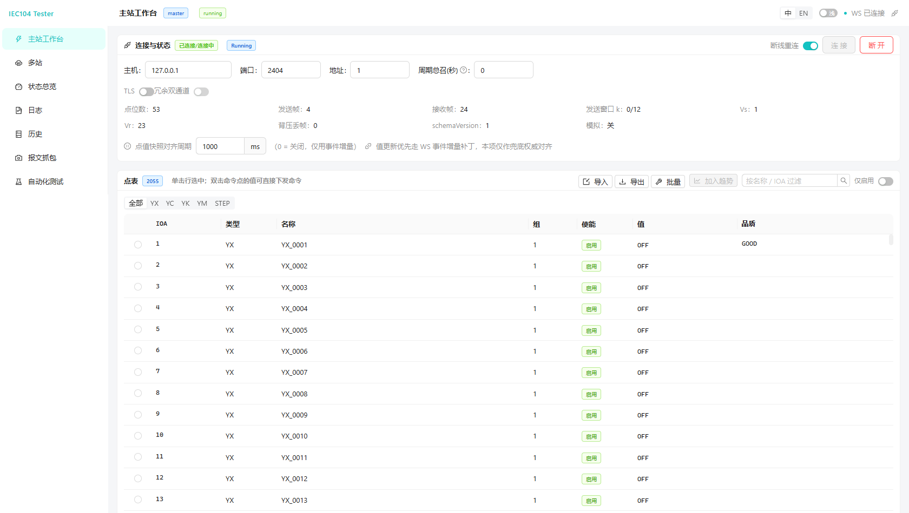
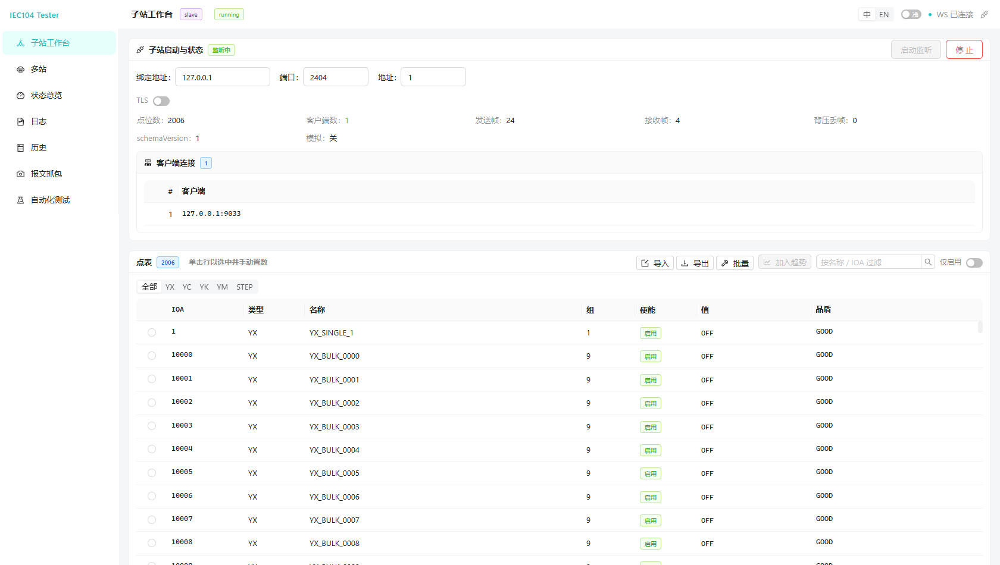
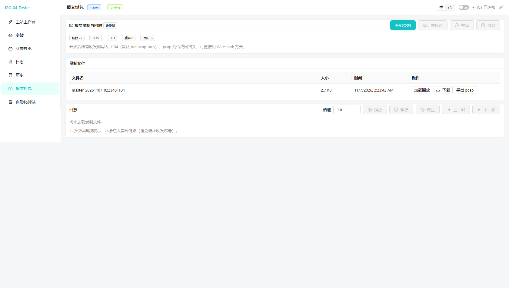
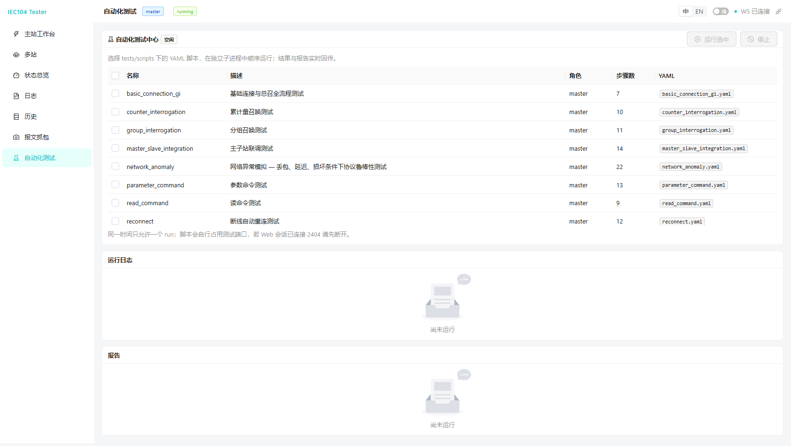

<p align="center">
  
</p>

<h1 align="center">IEC 60870-5-104 Tester</h1>

<p align="center">
  <a href="README_eng.md">English</a> | <a href="README.md">中文</a>
</p>

<p align="center">
  
  
  
  
  
  
</p>

---

工业级 IEC 60870-5-104 协议测试工具：主站/子站**单页浏览器工作台**（浏览器为唯一界面，同一进程、同一端口内切换主站/子站），协议引擎完整；附三套可即时切换的 UI、SCD 点表导入、透明桥与旁路合规监视、报文录制回放、YAML 自动化测试、压测编排、测试报告导出、TLS 传输加密与历史库。

> 版本说明：当前发布基线 **v1.8.0**（2026-11-09）——桥上网络条件注入（混沌验收）、
> 应用层合规规则第二批（合规规则合计 28 项）、测试报告嵌历史曲线快照。逐版特性见
> [`CHANGELOG.md`](CHANGELOG.md)；已交付能力与后续计划见 [`PROJECT.md`](PROJECT.md)。

### 界面预览

三套界面在同一地址 `/app/` 内即时切换（默认 **Carbon**，右下角 UI 圆钮或 `?kit=` 指定）：

| 主站工作台 | 子站工作台 |
|---|---|
|  |  |
| **报文抓包 / pcap 导出** | **自动化测试中心** |
|  |  |

> 截图为 v1.3.x 经典版界面留档；当前默认 Carbon，页面与功能一一对应。
> 新 logo 的多尺寸效果见 [logo 预览](docs/pr-assets/logo-preview.png)（[SVG 图标](resources/icon.svg) / [横版 wordmark](resources/logo.svg)）。

## ✨ 功能特性

### 协议实现（`core/protocol`）

- 72 个已定义 TypeID 全部可构造/可解码（标准类型 + CP24/继保事件/成组单点/无品质/位模式等变体）+ **非标厂商私有 TypeID 注册**（YAML 声明字段即可编解码往返，未注册仍按标准回 COT=42）
- APCI I/S/U 帧；k-w 流控；t0/t1/t2/t3 定时器；STARTDT/STOPDT/TESTFR 状态机
- CP24Time2a / CP56Time2a；品质描述词按 **IEC 60870-5-101** 标准化（`IV/NT/SB/BL/OV` 五位置）
- **文件传输**（F_FR/F_SR/F_SC/F_LS/F_AF/F_SG/F_DR 及 F_*_NB 确认）字节级语义已按多个独立参考实现逐字节核实（详见 [`docs/file_transfer_fls.md`](docs/file_transfer_fls.md)），并经 lib60870-C v2.4.1 第三方从站实测互操作
- **TLS 传输层加密**（证书/CA 校验、双向认证 mTLS；⚠ 仅传输层加密，**不等于 IEC 62351 合规**，边界见 [`docs/tls.md`](docs/tls.md)）

### Web UI（三套界面共存，深色/浅色双主题）

- **三套 UI 同地址即时切换**：`Carbon`（IBM Carbon Design System，默认）/ `PatternFly 6` / `经典版`（antd 6，v1.3.1 冻结快照）在 `/app/` 同一文档内切换——不刷新、不改 URL、不断 WS/连接，页面/深浅主题/语言保持；详见 [`docs/ui_kits.md`](docs/ui_kits.md)
- **主站工作台**：十万行点表虚拟滚动（只渲染可视窗口）、命令面板（系统命令/遥控/设点/步/比特串/延时/参数/文件命令）、实时报文查看器（悬停 HEX 逐段翻译）、点位趋势图（只采样被订阅点位）、**测量时钟偏差**（按子站确认帧携带的子站时钟计算 ms 偏差）
- **子站工作台**：点表编辑与手动置数、**应答行为配置**（延迟/丢帧/损坏/不响应/品质/错误 COT）、数据模拟（手动/自动、YX/YC 独立开关）、**SCD/CID/ICD 点表导入**（IEC 61850-80-1 精确映射优先 + 无映射按 CDC 推断，先预览再应用）
- **多站页**：多子站卡片管理与聚合状态
- **桥接观察页**（`--mode bridge`，8767）：**透明桥 / 旁路监听**真实主站 ↔ 测试器 ↔ 真实子站；字节级透传（转发优先于观察）、双向帧/字节/客户端/重同步统计、实时报文；**协议合规监视**（传输层序号/确认/U 时序/k/t1/t2/t3 + 应用层方向错位/无请求响应/总召唤未终止/非召唤期数据/COT=0/公共地址不符/重复自发帧/时标偏离，合计 28 项规则），违规实时进页面与测试报告；**网络条件注入（混沌验收）**：丢帧/重复/损坏/延迟/乱序/断线率作用于转发路径，旁路观察与合规监视始终看**干扰前**的原始帧，注入统计进报告；**TLS 透传桥**双侧独立 TLS（明文↔TLS 混合桥接，TLS 终结在桥、帧内容解密可见）
- **报文抓包页**：录制启停/暂停、文件列表与下载、一键导出 pcap/pcapng（Wireshark 可打开）、离线回放（播放/暂停/单步/倍速）
- **自动化测试页**：选择 `tests/scripts/*.yaml`，子进程隔离运行，实时日志 + 通过/失败汇总 + HTML/JSON/TXT 报告下载；**压测编排**（目标速率 1~10000 事件/秒、时长可配、**1~8 条并发连接**分别统计帧数/字节/错误）
- **状态总览页**：一键导出**测试报告**（自包含单文件 HTML，打印即 PDF；会话信息 + 帧统计 + 逐帧解码证据 + 事件表 + 压测汇总 + **结论横幅**合格/不合格/有条件通过 + 历史曲线快照）；一键诊断包、导出数据/报文记录
- **历史页**：按时间/类型/IOA/方向查询数据与报文并导出 CSV；**「曲线」页签**按类型 + IOA 添加 1~8 个序列回放历史趋势（遥信/遥脉阶梯、遥测折线）
- **日志页**：结构化日志分级/分类/来源过滤、关键字搜索、暂停/清空、JSONL 导出
- 深色/浅色主题切换（首次跟随系统偏好，手动切换后记忆）；**中/英界面切换**（头部「中 / EN」，全站双语，`npm run i18n:inventory` 迁移清单为 0）
- 安全：`--auth-token` 访问令牌、`--web-tls-cert/--web-tls-key` HTTPS、CSP/X-Frame-Options/Referrer-Policy 安全头；WCAG AA 文本/非文本对比度门禁、UI 自动巡检与视觉回归基线
- 点值经 WebSocket 实时刷新；按钮可用性由服务端状态驱动；API 响应契约单一源（每次响应强制 schema 校验）

### 主站（`core/engine/master.py`）

- 连接管理、断线重连；**冗余双通道**（主备自动切换 + 切换窗口去重，见 [`docs/redundancy.md`](docs/redundancy.md)）
- 总召唤 / **组召唤（1–16 组；20=站召唤）**、累计量召唤、时钟同步、复位进程、测试命令
- 单/双命令（SBO 两段式/直发）、设点（短浮点/归一化/标度化）、读命令、参数命令、文件目录/选择/请求/确认
- 点位自学习（报文中出现而定义表没有的 IOA 自动补点）、周期总召唤、定义表批量改组/启用禁用、YAML 导入导出、CSV/会话 JSON 导出
- 定义表双击值直接下发命令（YK/YC/STEP 经确认弹窗；SBO 仍走选择-执行，不绕过）
- 实时报文列表（U/S/I + TypeID 摘要）、事件日志

### 子站（`core/engine/slave.py`）

- TCP 多客户端监听；系统命令响应；DEACT；SOE/自发上送
- 可编辑点表（点 YX 切换、改 YC 自发上送）
- **响应注入**（延迟、丢帧、损坏、不响应、品质、错误 COT）
- **命令联动**（真机语义：遥控→同 IOA 遥信变位、遥调→同 IOA 遥测更新、升降→档位点更新，带时标 COT=3 上送）
- 数据模拟（手动/自动、YX/YC 独立开关）；YAML/SCD 点表；步位置（STEP）点建模

### 数据、运维与质量

- **历史库默认开启**（SQLite，按角色分库），`--no-history` 可关闭；保留期/条数/容量三重清理；**Web「历史」页**按时间/类型/IOA/方向查询数据与报文记录并导出 CSV
- **报文导出**：`.i104` / `.json` / **pcap / pcapng**（Wireshark 可直接打开）
- **一键诊断包**：状态/配置（私钥脱敏）/日志/报文/事件/点表/历史统计打包下载（状态页按钮或 `GET /api/diagnostics/export`）
- **一键环回演示**：`python app.py --demo`（本机子站+主站自动监听/连接/总召）
- 质量门禁：互操作语料库回放、Hypothesis fuzz、20 客户端并发、2h 环回 soak、分支覆盖合并 91.3%（门禁 91%，webui 独立门禁 85%）、协议层变异 12/12
- 多站并发（`run_multi_station.py`）、网络异常模拟（**Web 状态页卡片** / `sim_tool.py`）、YAML 自动化测试（`run_tests.py`）

### 打包与发布

- `python build/build_all.py` 一键产出**一个**免安装目录 **`dist/iec104-tester/`**（含 Web 前端、配置、资源）；`--onefile` 产出**单个** `iec104-tester.exe`（Linux 为 `iec104-tester`）
- 双击 exe 默认**同时启动主站+子站**，只打开**一个页面**：左侧「主站工作台 / 子站工作台」两个菜单，点哪个就在同一页面显示哪个；也可命令行运行 `iec104-tester --mode master|slave|both|bridge`
- 打 `v*` tag 触发双平台发布流水线：版本校验 → Windows/Linux onefile → **同一 exe 的主站/子站启动冒烟** → `SHA256SUMS` → GitHub Release（详见 [`docs/user_guide.md`](docs/user_guide.md)）

## 🚀 快速开始

```bash
pip install -r requirements.txt

# 直接运行：默认同时启动主站+子站（--mode both），打开一个单页工作台
python app.py

# 显式指定角色（单角色模式，各自自动打开浏览器）
python app.py --mode master    # 主站，默认 http://127.0.0.1:8765/
python app.py --mode slave     # 子站，默认 http://127.0.0.1:8766/
python app.py --mode both      # 单页工作台（左侧两个角色菜单，默认同此）

# 透明桥 / 旁路观察（真实主站改连桥端口）
python app.py --mode bridge --listen-port 2404 --upstream-host 192.168.1.50 \
    --upstream-port 2404

# 无窗口/服务器场景：不自动开浏览器，仅打印地址
python app.py --mode master --no-browser --http-port 8765
```

服务启动后会在默认浏览器自动打开对应页面；用 `--no-browser` 可关闭自动打开。
`both` 模式是**单进程双角色、一个 HTTP 端口（8765）**：主站 API 在 `/api/*`，
子站 API/WS 在 `/slave/api/*`、`/slave/ws`；页面内左侧菜单切换，不再有 8766/iframe。
子站菜单「启动监听」→ 主站菜单「连本地」→「立即总召」即可联调。

### 一键环回演示（推荐首次体验）

```bash
python app.py --demo
```

一条命令在本机启动单进程双角色（一个 HTTP 端口），自动完成「子站监听 → 主站连接 →
总召」，并打开工作台；历史库自动关闭，Ctrl+C 停止进程。

### 手动联调示例（两个终端）

```bash
# 终端 1：子站（默认生成演示点表，历史库开启）
python app.py --mode slave --port 2404 --no-browser

# 终端 2：主站（连接后自动 STARTDT，手动点总召；或 --mode master --no-browser 后看日志）
python app.py --mode master --host 127.0.0.1 --port 2404 --no-browser
```

主站页面连接成功后点「立即总召」，子站演示点表的遥信/遥测即出现在主站定义表。

## 📦 安装

```bash
git clone https://github.com/si1entages/iec104-tester.git
cd iec104-tester
python -m venv venv
# Windows:
venv\Scripts\pip install -r requirements.txt
# Linux/macOS:
venv/bin/pip install -r requirements.txt
```

运行依赖：`PyYAML`、`aiohttp`。

```bash
# 开发/测试（pytest、pytest-asyncio、pytest-cov、hypothesis、psutil、ruff）
pip install -e ".[dev]"

# 打包（pyinstaller）
pip install -e ".[build]"

# 前端（React 19 / Vite / Carbon / PatternFly；产物落在 webui/static/app/）
cd webui/frontend && npm ci && npm run build
```

## 💻 命令行

```bash
# 兼容入口（启动 Web 服务）
python app.py --mode master
python app.py --mode slave --port 2404

# 一键环回演示（本机子站+主站，自动连接并总召）
python app.py --demo
python app.py --demo --demo-seconds 30 --no-browser   # 30s 后自动停止

# 无界面引擎
python app.py --mode slave --no-gui --log-level DEBUG

# 关闭历史库
python app.py --mode slave --no-history

# TLS（测试证书见 tests/certs/，生成方式见该目录 README）
python app.py --mode slave --tls --tls-cert tests/certs/server.pem --tls-key tests/certs/server.key
python app.py --mode master --tls --tls-ca tests/certs/ca1.pem --host 127.0.0.1

# 自动化测试脚本
python run_tests.py tests/scripts/

# 报文录制 / 导出 pcap
python capture_tool.py record --mode master --host 127.0.0.1 -o session.i104
python capture_tool.py convert session.i104 -o session.pcap

# 多站
python run_multi_station.py --stations 3

# 网络异常
python sim_tool.py --preset poor_wifi --mode master --host 127.0.0.1
```

### 主要参数

| 参数 | 说明 | 默认 |
|------|------|------|
| `--mode` | 运行模式 master / slave / both / **bridge** | `both`（`python app.py` 不带参数时） |
| `--config` | 配置文件路径 (YAML) | — |
| `--host` / `--port` | 目标 TCP 地址 / 端口 | 127.0.0.1 / 2404 |
| `--point-table` | 点表文件路径 (YAML) | — |
| `--log-level` / `--log-file` | 日志级别 / 日志文件 | INFO / — |
| `--history-db` | 历史数据库路径 (SQLite) | — |
| `--no-history` | 关闭历史库（默认开启） | false |
| `--no-gui` | headless CLI 模式（仅日志输出） | false |
| `--test` | 运行自动化测试脚本 (YAML 文件或目录) | — |
| `--report-dir` | 自动化测试报告输出目录 | test_reports |
| `--http-port` | Web UI HTTP 端口 | both/master 8765；单独 `--mode slave` 8766；bridge 8767 |
| `--http-host` | Web UI 监听地址（0.0.0.0 会暴露到局域网） | 127.0.0.1 |
| `--auth-token` | Web API 访问令牌（可选；亦可读环境变量 `IEC104_AUTH_TOKEN`） | — |
| `--web-tls-cert` / `--web-tls-key` | Web UI HTTPS 证书 / 私钥 (PEM)；设置后 Web 服务走 HTTPS | — |
| `--version` | 打印版本号并退出 | — |
| `--no-browser` | 启动 Web 服务时不自动打开浏览器 | false |
| `--demo` | 一键环回演示：本机子站+主站并自动连接 | false |
| `--demo-seconds` | 演示运行 N 秒后自动停止（0=直到 Ctrl+C） | 0 |
| `--tls` | 启用 TLS 传输加密 | false |
| `--tls-cert` / `--tls-key` | 本端证书 / 私钥 (PEM) | — |
| `--tls-ca` | 受信 CA (PEM) | — |
| `--no-verify` | 主站跳过服务端证书校验（仅自签联调，生产禁用） | false |
| `--verify-client` | 子站要求并校验客户端证书（mTLS） | false |
| `--tls-hostname` | 主站 TLS 主机名校验域名 | — |
| `--listen-host` / `--listen-port` | **[bridge]** 面向真实主站的监听地址 / 端口 | 0.0.0.0 / 2404 |
| `--upstream-host` / `--upstream-port` | **[bridge]** 上游真实子站地址 / 端口（headless 时必填地址） | — / 2404 |
| `--capture-file` | **[bridge]** 旁路帧录制文件（.bin/.json/.pcap，按扩展名分派） | — |
| `--bridge-listen-tls-cert` / `-key` | **[bridge]** 监听侧证书/私钥：桥对主站扮演 TLS 子站 | — |
| `--bridge-upstream-tls-ca` | **[bridge]** 上游受信 CA：桥以 TLS 接入真实子站 | — |
| `--bridge-upstream-tls-cert` / `-key` / `-hostname` | **[bridge]** 上游 mTLS 客户端证书 / 私钥 / 主机名校验 | — |

> 共 **39** 个参数，与 `python app.py --help` 一致。`--no-browser` / `--demo` 仅 Web UI 入口生效；bridge 专属参数见 [`docs/user_guide.md`](docs/user_guide.md)。
> 监听非回环地址（`--http-host 0.0.0.0`）时请同时设置 `--auth-token`；未设置会打印醒目告警。

## ⚙️ 配置

```bash
cp resources/config_template.yaml config.yaml
```

```yaml
mode: master
connection: { host: "192.168.1.100", port: 2404, common_addr: 1, reconnect: true }
timers: { t0: 30, t1: 15, t2: 10, t3: 20 }
flow_control: { k: 12, w: 8 }
history:   { enabled: true, retention_days: 7, max_size_mb: 512 }
tls:       { enabled: false }
custom_types: []   # 非标厂商私有 TypeID 注册
```

完整字段说明见 [`docs/user_guide.md`](docs/user_guide.md) 第 9 节；多站配置见 `configs/multi_station_example.yaml`。

## 🧪 测试

```bash
python -m pytest tests/ -q              # 单元 + 集成（1655 例；性能基准默认排除）
python -m pytest tests/ -q --cov=core --cov-branch --cov-report=term-missing --cov-fail-under=91
python -m pytest tests/ -m perf -q      # 性能基准（解码/10 万点/20 客户端并发/环回 soak）
IEC104_SOAK_SECONDS=7200 python -m pytest tests/perf/test_soak_loopback.py -m perf -q
python run_tests.py tests/scripts/      # YAML 脚本
python -m pytest tests/test_conformance_suite.py -q  # 一致性套件（50 case）接入 pytest
python tests/e2e/qa_full_flow.py        # 全流程验收（12 阶段；CI job e2e-full-flow）
python tools/mutation_smoke.py          # 协议层变异冒烟（12/12 必须被杀死）
```

- 当前基线：**1655 passed，4 deselected**（v1.8.0 发布基线 1654 + 版本/文档一致性守卫 1 例）+ 前端单测 **133 passed** + Playwright e2e **46 passed**；`core/` 92.0%、`webui/` 89.0%，合并 **91.3%**（CI 口径 `--cov=core --cov=webui --cov-branch --cov-fail-under=91`，webui 独立门禁 85%）
- 20 客户端并发实测约 **2.9k 帧/秒**；2h soak 实测 **7200s / 34,765 次 GI / 内存 +0.64 MB**
- 互操作语料库：`tests/fixtures/frames/`（合成基线 + `real/` 真机目录），
  `tests/test_frame_corpus_replay.py` 做 golden 解码与主站回放回归；
- 协议 fuzz：`tests/test_protocol_fuzz.py`（Hypothesis；APCI/ASDU/文件传输畸形输入只允许 `ValueError`）；
- Playwright e2e：API 契约对拍、UI 巡检（8 页 × 3 视口 × 中英/深浅）、WCAG AA 对比度、视觉基线回归；本地运行需 `NODE_PATH=webui/frontend/node_modules`（CI 同款）；
- 诊断包：Web 状态页「导出诊断包」或 `GET /api/diagnostics/export`。

## 🏗 项目结构

```
iec104-tester/
├── app.py                 # CLI/Web 兼容入口（--demo 一键环回 / --mode both|bridge）
├── apps/                  # 源码瘦入口 web_master / web_slave（打包统一用根 app.py）
├── webui/                 # aiohttp REST+WS + React 前端（构建产物在 webui/static/app/）
│   ├── bridge.py          # 引擎桥（master/slave/both/bridge 角色）
│   ├── diagnostics.py     # 一键诊断包
│   ├── report.py          # 测试报告 HTML 生成
│   ├── server.py
│   ├── frontend/src/      # 共享数据层 + 三套 UI（carbon/ 默认、pf/、classic/）
│   └── static/app/        # Vite 构建产物
├── core/
│   ├── protocol/          # APCI/ASDU/类型/流控/文件传输/自定义类型
│   ├── engine/            # master / slave / multi_station / tcp_bridge / compliance_monitor / condition_injector
│   ├── transport/         # TCP / TLS
│   ├── data/              # 点表、实时库、历史库、SCD 导入
│   ├── capture/           # 录制回放（.i104/.json/pcap/pcapng）
│   ├── simulation/        # 网络异常
│   └── testing/           # YAML 脚本引擎
├── build/build_all.py     # PyInstaller 打包（onedir / --onefile）
├── tools/mutation_smoke.py
├── tests/
│   ├── fixtures/frames/   # 互操作语料库（合成基线 + real/）
│   ├── perf/              # 性能/长稳基准（-m perf）
│   └── e2e/               # Playwright 真实浏览器验收
├── .github/workflows/     # CI + tag 发布流水线
├── run_tests.py / run_multi_station.py / capture_tool.py / sim_tool.py
├── configs/ resources/ docs/
└── requirements.txt
```

## 📖 文档

- 更新日志：[`CHANGELOG.md`](CHANGELOG.md)（v1.0.0 → v1.8.0 逐版特性）
- 进度与路线：[`PROJECT.md`](PROJECT.md)、[`docs/architecture_plan.md`](docs/architecture_plan.md)
- 用户手册：[`docs/user_guide.md`](docs/user_guide.md)（含 Web UI 各工作台、一键演示、诊断包、TLS、历史库、配置参考、已知限制）
- 界面设计规范：[`docs/design_guidelines.md`](docs/design_guidelines.md)（组件模式/颜色语义/点表/告警/IEC104 语义映射/命令安全/无障碍/评审清单）
- 三套 UI 共存与切换：[`docs/ui_kits.md`](docs/ui_kits.md)
- TLS 边界与排查：[`docs/tls.md`](docs/tls.md)
- 文件传输字节语义核实：[`docs/file_transfer_fls.md`](docs/file_transfer_fls.md)
- 文件传输真机核实清单/探针：[`docs/file_transfer_open_items.md`](docs/file_transfer_open_items.md)
- pcap 导出：[`docs/pcap_export.md`](docs/pcap_export.md)
- 历史库实测数据：[`docs/history.md`](docs/history.md)
- 冗余双通道：[`docs/redundancy.md`](docs/redundancy.md)
- 互操作语料库：[`tests/fixtures/frames/README.md`](tests/fixtures/frames/README.md)
- 性能/长稳基准：[`tests/perf/README.md`](tests/perf/README.md)

## ⚠️ 已知限制（按用户要求暂缓）

以下两项需要**外部输入**（真机窗口 / 真实厂商样本）才能推进，因此当前实现只做已核实部分，
未核实处一律在代码与文档中标注「待核实」，**不臆测实现**：

- **文件传输真机复测**：NOF / SCQ / WITH_DEACT / 多节 / FRQ-SRQ 五项开放语义已用第三方从站
  **lib60870-C v2.4.1** 实测回填，并据此修正了三处互操作问题（文件命令改 `F_SC_NA_1(122)+COT=13`、
  `F_SR` 后自动发 `SCQ=6` 节请求、停发非标准 `F_FR_NB(128)/F_SR_NB(129)`）；**真机到位后仍需逐项复测**。
  清单与只读探针见 [`docs/file_transfer_open_items.md`](docs/file_transfer_open_items.md)、
  字节语义核实见 [`docs/file_transfer_fls.md`](docs/file_transfer_fls.md)。
- **SCD 私有映射适配**：IEC 61850-80-1 标准映射（`Private/Address(casdu,ioa,ti)`，ti 优先）已支持；
  各厂商对 104 的**私有映射扩展**需 ≥2 份真实 SCD 样本才能归纳规则，当前按 DOType `cdc` 推断兜底
  （见 [`docs/user_guide.md`](docs/user_guide.md) 第 11 节）。

> 已交付能力与下一迭代计划（v1.9.0）见 [`PROJECT.md`](PROJECT.md)、[`docs/architecture_plan.md`](docs/architecture_plan.md)。

## 🤝 贡献 / 许可

MIT — 见 [LICENSE](LICENSE)。

## 🙏 致谢

- [IEC 60870-5-104](https://webstore.iec.ch/en/publication/6270)
- [aiohttp](https://docs.aiohttp.org/) · [IBM Carbon](https://carbondesignsystem.com/) · [PatternFly](https://www.patternfly.org/) · [React](https://react.dev/)

---

<p align="center">Made for the power systems community</p>
