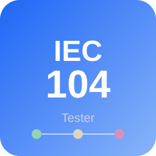

<p align="center">
  
</p>

<h1 align="center">IEC 60870-5-104 Tester</h1>

<p align="center">
  <a href="README_eng.md">English</a> | <a href="README.md">中文</a>
</p>

<p align="center">
  
  
  
  
  
</p>

---

Industrial IEC 60870-5-104 testing tool: browser-based **Web UI** for both master and slave
(pure web — the browser is the only UI), full protocol engine, multi-station, packet
capture/replay, network fault injection, YAML scripted tests, TLS, history DB, one-click
diagnostics and a one-command loopback demo.

## Features

### Protocol (`core/protocol`)

- **72 defined TypeIDs**: all constructible and decodable (standard types plus CP24,
  protection events, grouped single points, no-quality and bit-pattern variants)
- APCI I/S/U, k-w flow control, t0–t3 timers, STARTDT/STOPDT/TESTFR state machine
- CP24/CP56 time tags, quality descriptors
- **File transfer** (F_FR/F_SR/F_SC/F_LS/F_AF/F_SG/F_DR and F_*_NB ACKs) with
  byte-level semantics verified against independent reference implementations
- **TLS transport encryption** (CA verification, mutual TLS). ⚠ Transport-layer
  encryption only — **not** full IEC 62351 compliance; see [`docs/tls.md`](docs/tls.md)
- Vendor-private TypeID registration via YAML; unregistered types still reply COT=42

### Web UI (ISA-101 light industrial style, dark/light theme)

- **Master workbench**: 100k-row virtualized point table, command panel
  (system/control/setpoint/step/bitstring/delay/parameter/file), live frame viewer with
  per-segment HEX hover translation, per-point trend chart
- **Slave workbench**: point-table editing/manual values, response injection
  (delay/drop/corrupt/no-response/quality/wrong COT), manual/auto simulation (YX/YC range mode)
- **Multi-station page**: station cards and aggregated status
- **Logs page**: structured logs with level/category/source filters, search, pause/clear,
  JSONL export
- Dark/light theme follows the system on first launch and remembers manual choice
- WebSocket live refresh; button availability driven by server state

### Master (`core/engine/master.py`)

- Connect/reconnect, **redundant dual channel** (primary/standby switching + dedup)
- GI / **group interrogation (groups 1–16; 20 = station GI)**, counter interrogation,
  clock sync, reset, test command
- Single/double commands (SBO two-stage/direct), setpoints, read, parameters,
  file directory/select/request/ack
- Point auto-learning, periodic GI, batch enable/group, YAML import/export,
  CSV/session JSON export
- Double-click a point value to send a command (YK/YC/STEP with confirmation; SBO is
  still select-before-execute)

### Slave (`core/engine/slave.py`)

- Multi-client TCP server; system commands; DEACT; SOE/spontaneous reporting
- Editable point table; manual values; YAML point table; STEP position modeling
- **Response injection** (delay, drop, corrupt, no-response, quality, wrong COT)
- **Command feedback** (real-device semantics: control → same-IOA YX change,
  setpoint → same-IOA YC update, step → position update, sent as time-tagged COT=3)
- Manual/auto simulation with YX/YC range mode

### Data, operations and quality

- **History DB on by default** (SQLite, per-role file), disable with `--no-history`;
  retention/count/size cleanup; **Web "History" page** queries data/frame records
  (time/type/IOA/direction filters) and exports CSV
- **Capture export**: `.i104` / `.json` / **pcap / pcapng** (Wireshark-ready)
- **One-click diagnostics**: status/config (private-key path redacted)/logs/frames/events/
  points/history stats as a ZIP (status-page button or `GET /api/diagnostics/export`)
- **One-command loopback demo**: `python app.py --demo`
- Quality gates: interop corpus replay, Hypothesis fuzz, 20-client concurrency,
  2-hour loopback soak, 88.82% branch coverage, 12/12 mutation smoke killed
- Multi-station (`run_multi_station.py`), network fault injection (status-page card /
  `sim_tool.py`), YAML scripted tests (`run_tests.py`)

### Packaging and release

- `python build/build_all.py` produces `dist/iec104-master` / `dist/iec104-slave`
  (web UI, configs and resources included); `--onefile` builds single-file executables
- Pushing a `v*` tag runs the release pipeline: version check → Windows/Linux onefile
  builds → startup smoke → `SHA256SUMS` → GitHub Release

## Quick start

```bash
pip install -r requirements.txt

# master / slave Web services (each opens the browser)
python app.py --mode master    # http://127.0.0.1:8765/
python app.py --mode slave     # http://127.0.0.1:8766/

# thin entry scripts (equivalent)
python apps/web_master.py
python apps/web_slave.py

# one-command loopback demo: slave + master + auto connect + GI
python app.py --demo

# headless/server: no browser, just print the URL
python app.py --mode master --no-browser --http-port 8765
```

`--demo` starts both roles on free local ports, enables the slave listener, connects the
master and performs a GI, then opens the master page. Use `--demo-seconds N` to stop
automatically; `Ctrl+C` stops all child processes.

Manual interop: start master and slave in two terminals → slave page “Start listening” →
master page “Connect local” → “GI now”.

## Install

```bash
git clone https://github.com/si1entages/iec104-tester.git
cd iec104-tester
python -m venv venv
# Windows:
venv\Scripts\pip install -r requirements.txt
# Linux/macOS:
venv/bin/pip install -r requirements.txt
```

Runtime deps: `PyYAML`, `aiohttp`.

```bash
# development/test (pytest, pytest-asyncio, pytest-cov, hypothesis, psutil, ruff)
pip install -e ".[dev]"

# packaging (pyinstaller)
pip install -e ".[build]"
```

## CLI

```bash
python app.py --mode master
python app.py --mode slave --port 2404
python app.py --demo
python app.py --mode slave --no-gui
python app.py --mode slave --no-history
python run_tests.py tests/scripts/
python tests/conformance/test_conformance.py
python capture_tool.py record|play|analyze ...
python capture_tool.py convert session.i104 -o session.pcap
python sim_tool.py --preset poor_wifi
python run_multi_station.py --stations 3
```

## Tests

```bash
python -m pytest tests/ -q              # unit + integration (1308; perf excluded)
python -m pytest tests/ -q --cov=core --cov-branch --cov-report=term-missing --cov-fail-under=88
python -m pytest tests/ -m perf -q      # decode / 100k snapshot / 20 clients / soak
IEC104_SOAK_SECONDS=7200 python -m pytest tests/perf/test_soak_loopback.py -m perf -q
python run_tests.py tests/scripts/
python tests/e2e/qa_full_flow.py
python tests/e2e/qa_webui_e2e.py --spawn
python tests/e2e/qa_real_device.py
python tools/mutation_smoke.py
```

- Baseline: **1308 passed, 4 deselected**; `core/` branch coverage **88.82%** (gate 88%)
- 20-client concurrency: about **2.9k frames/s**; 2-hour soak: **7200s / 34,765 GI /
  +0.64 MB memory**
- Interop corpus: `tests/fixtures/frames/` (synthetic baseline + `real/` for user-provided
  device captures); golden decode and master replay in `tests/test_frame_corpus_replay.py`
- Fuzz: `tests/test_protocol_fuzz.py` (Hypothesis; APCI/ASDU/file-transfer inputs may only
  raise `ValueError`)
- Diagnostics: status-page “Export diagnostics” or `GET /api/diagnostics/export`

## Project layout

```
iec104-tester/
├── app.py                 # CLI/Web entry (including --demo)
├── apps/                  # thin entries web_master / web_slave (packaging)
├── webui/                 # aiohttp REST+WS + React SPA (built into webui/static/app/)
│   ├── bridge.py          # engine bridge
│   ├── diagnostics.py     # one-click diagnostics ZIP
│   ├── server.py
│   └── static/
├── core/
│   ├── protocol/          # APCI/ASDU/types/flow control/file transfer/custom types
│   ├── engine/            # master / slave / multi_station
│   ├── transport/         # TCP / TLS
│   ├── data/              # point table, realtime DB, history DB
│   ├── capture/           # recording/playback (.i104/.json/pcap/pcapng)
│   ├── simulation/        # network fault injection
│   └── testing/           # YAML script engine
├── build/build_all.py     # PyInstaller (onedir / --onefile)
├── tools/mutation_smoke.py
├── tests/
│   ├── fixtures/frames/   # interop corpus (synthetic + real/)
│   ├── perf/              # performance/soak benchmarks (-m perf)
│   └── e2e/               # real-socket acceptance scripts
├── .github/workflows/     # CI + tag-based release
├── run_tests.py / run_multi_station.py / capture_tool.py / sim_tool.py
├── configs/ resources/ docs/
└── requirements.txt
```

## Docs

- User guide: [`docs/user_guide.md`](docs/user_guide.md)
- TLS boundaries: [`docs/tls.md`](docs/tls.md)
- File-transfer byte semantics: [`docs/file_transfer_fls.md`](docs/file_transfer_fls.md)
- pcap export: [`docs/pcap_export.md`](docs/pcap_export.md)
- History DB measurements: [`docs/history.md`](docs/history.md)
- Interop corpus: [`tests/fixtures/frames/README.md`](tests/fixtures/frames/README.md)
- Performance/soak: [`tests/perf/README.md`](tests/perf/README.md)

## License

MIT — see [LICENSE](LICENSE).
