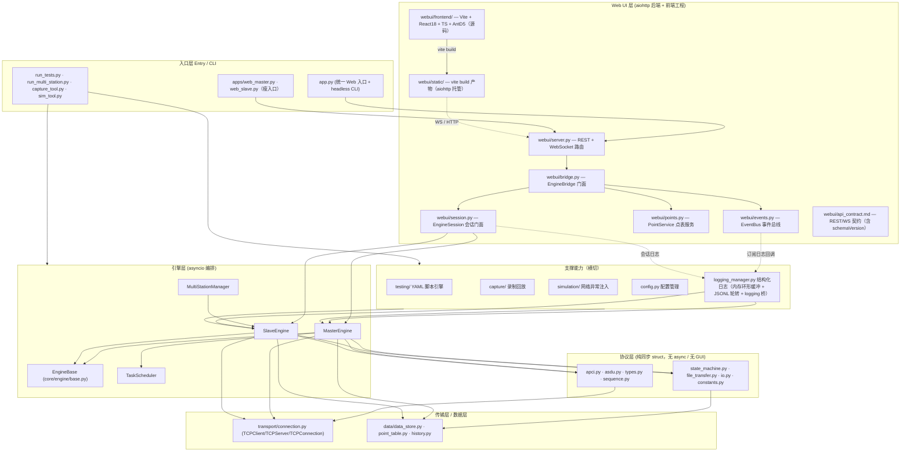
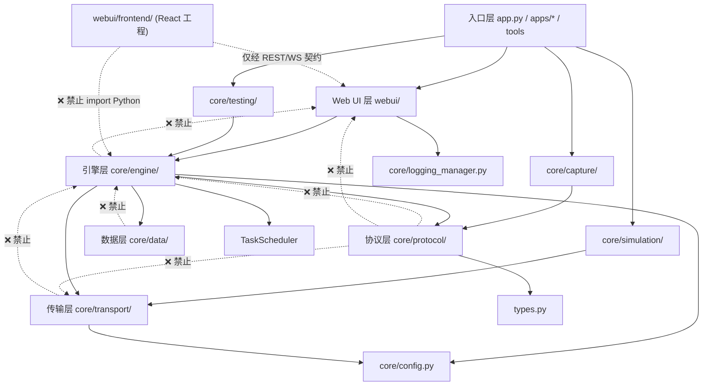
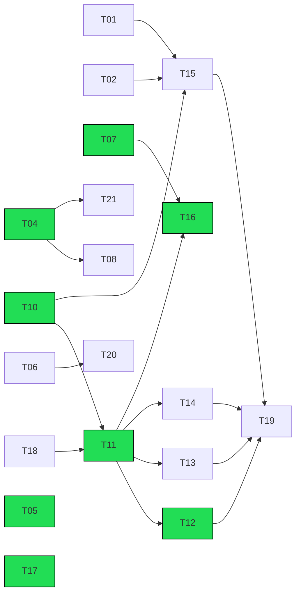

# IEC 60870-5-104 Tester — 架构说明与任务分解方案

> 作者：架构师 高见远（software-architect）· 主理人 齐活林（交付总监）
> 版本：**v1.2（新基线增量修订 · 含 2026-10-14 用户定调）**
> 适用仓库：`D:/PycharmProjects/iec104-tester`
> 基线：`pytest tests/ -q` → **489 passed**；`ruff check .` → **All checks passed**；HEAD = **`3367213`**（`feature/webui-refactor` 已 ff 合入 master，5 分支全部并入）
>
> **✅ Phase 0 基线收口已完成（2026-10-14）**：T01/T02/T03 全部落地，并通过两轮独立 QA 验证（489 passed · ruff 0 告警 · `core/` 覆盖率 63.63% · CI 门禁 60%）。本文件原写「482 passed」之处已同步为 489；末尾 v1.1→v1.2 修订摘要中的 482 属当时基线快照，保留不改。
> 上一版：v1.1（基线 `23eede7` / 405 passed）—— **v1.2 为增量修订，非重写**

本文档为「已有项目」的整体架构梳理与落地任务分工方案，分 9 部分 + 2 附录。**v1.2 变更说明见文末「修订摘要」。**

---

## 0. 关键决策记录（2026-10-14 用户定调）

> ⚠️ **v1.2 更正**：v1.1 中 Q1/Q5 的「保留 pywebview 双通道」表述**与实测现状冲突**。新 master 已**移除 pywebview 桌面壳**（`requirements.txt`/`pyproject.toml` 无 pywebview；`PROJECT.md`：「纯 web 形态：移除 pywebview 桌面壳 / `--no-shell` / web_lab 一键联调」；`grep -rin pywebview` 在源码零命中）。故 Q1/Q5 按**现状**修正。

本次定调中 **4 项偏离原默认建议**（🔴 标出），对架构与排期影响显著：

| # | 决策项 | 原默认建议 | **最终决策（v1.2 修正后）** | 影响 |
|---|--------|-----------|-------------|------|
| Q1 | 发布形态 | ~~保留 pywebview + 浏览器双通道~~ | ✅ **纯 Web（浏览器为唯一 UI）**；保留可选 headless CLI（`--no-gui`）。**桌面壳已不存在** | 依赖裁剪、打包、UX 均按纯 Web |
| Q2 | TLS / IEC 62351 | 本轮不做 | ✅ 本轮不做（Phase 4 按需） | 无 |
| Q3 | pcap/pcapng 导出 | 建议做 | ✅ 做（Phase 4） | 无 |
| Q4 | God Class 拆分 | 先抽 EngineBase，深度拆分可裁剪 | ✅ **EngineBase 已完成（归档）**；深度拆分**优先级上调**（master 1326→1745、slave 1740→1950，反而恶化） | T04/T05 变为 P0 |
| Q5 | 保留 pywebview | ~~保留~~ | ✅ **维持已移除现状（纯 Web）**；不再引入桌面壳 | 与 Q1 一致 |
| **Q6** | 多站管理器接入 Web UI | 保持 CLI 独立 | 🔴 **接入 Web UI** | 新增「多站」页 + `/api/multi/*` + 多站桥；与 PROJECT.md 待办 #3（关停资源清理）耦合 → **T16** |
| **Q7** | 引入前端框架 | 暂不引入，保持原生零构建 | 🔴 **引入前端框架（Vite + React 18 + TS + Ant Design 5）** | 前端整体重写：`webui/frontend/`（源码）→ `vite build` → `webui/static/`（产物）；引入 Node 构建链；`build_all.py` 打包 `dist/`；CI 增 node 构建；现有 `webui/static/{master,slave}.html`、`js/app.js`(539)、`css/app.css`(315) 全部退役 → **T10~T15/T19** |
| Q8 | Python 基线 | 3.11+（CI 覆盖 3.11/3.13） | ✅ 同默认 | **需对齐**：`pyproject.toml` 现为 `requires-python=">=3.10"`、`target-version="py310"`；CI 现为 3.10/3.12 → **T01** |
| **Q9** | 历史库持久化 | 默认关闭，`--history-db` 显式开启 | 🔴 **默认开启** | `app.py` 现仅传 `--history-db` 时建库；`core/config.py` **无 history 配置项**；需新增默认数据目录 + `--no-history` 开关 + 保留期/容量上限/清理策略/写放大评估 → **T17** |
| Q10 | WS 消息版本协商 | 引入 `schemaVersion` | ✅ 同默认 | `webui/api_contract.md` 已存在但**无 `schemaVersion` 字段** → **T18** |

### 0.1 前端技术栈（Q7 细化，已确认）

| 项 | 选型 |
|----|------|
| 构建 | **Vite** |
| 框架 | **React 18 + TypeScript** |
| 组件库 | **Ant Design 5**（内置 `theme.darkAlgorithm` 暗色算法） |
| 数据/状态 | React Query（服务端状态 + WS 快照缓存） + Zustand（少量本地 UI 状态） |
| 样式 | antd Design Token 定制 + CSS Modules（**不引入 Tailwind**，避免与 antd 样式体系冲突） |
| 图表 | ECharts（趋势图） |
| 目录 | `webui/frontend/`（源码） → `vite build` → `webui/static/`（产物，aiohttp 托管） |

**选型理由**：本项目是**工业深色界面 + 十万行虚拟滚动点表 + 密集表单配置 + 高频报文流**场景。Ant Design 5 在中后台/工业配置类界面组件最齐全（暗色算法、`Table` 虚拟滚动、`Form` 校验、`Descriptions`/`Statistic`/`Badge`/`Drawer` 等），可用最小工作量替换现有粗糙组件，并具备组件化与前端自动化测试基建（Vitest + RTL + Playwright）。用户原话「目前的页面组件都太垃圾了」，为 Q7 直接动因。

---

## 1. 技术架构总览

### 1.1 分层架构图（v1.2：纳入 logging_manager、webui 拆分、前端工程）



**分层职责与边界**

| 层 | 职责 | 关键边界约束 |
|----|------|-------------|
| 入口层 | 解析 CLI 参数、装配配置与点表、选择运行模式（Web UI / CLI / 测试脚本 / 多站） | 不实现业务逻辑，只做装配与转发 |
| Web UI 层 | 提供 HTTP REST + WebSocket 接口；托管前端构建产物；**前端源码独立于后端** | 后端只经 `EngineBridge`/`EngineSession` 访问引擎；**前端只经 REST/WS 契约访问后端**，不 import 任何 Python |
| 引擎层 | 主站/子站会话编排、命令下发、应答处理、自发上送、多站管理、定时任务；公共骨架收敛于 `EngineBase` | 只依赖协议层/传输层/数据层的**公开接口**；不得被协议层反向依赖 |
| 协议层 | APCI/ASDU 编解码、TypeID 定义（**72 种**）、流控、状态机、文件传输 | **纯同步、无 asyncio、无 GUI、无网络**；可被任何上层调用 |
| 传输层 | TCP 连接/监听/收发/重连/统计，`close()` 幂等 | 不感知协议语义，只搬运字节 |
| 数据层 | 点表模型、实时库、历史库 | 纯数据结构，无 IO 副作用（历史库除外） |
| 支撑能力 | YAML 测试引擎、录制回放、网络异常模拟、配置、**结构化日志** | 横切复用，独立于 UI；日志经订阅回调推送给 Web 层 |

### 1.2 关键数据流 / 控制流（v1.2：前端为 React 工程）

**下行（控制流：UI 发命令）**
```
浏览器(React/antd) → HTTP POST /api/master/yk
  → webui/server.py: api_yk()
  → EngineBridge.send_yk() → EngineSession → MasterEngine.single_command()
  → ASDUBuilder 构建 ASDU → APCICodec 编码 I 帧 → SequenceManager 记账
  → transport.TCPClient.send() → TCP socket → 子站
```

**上行（数据流：收帧 → 事件推送）**
```
TCP socket → TCPClient.on_frame(bytes)
  → MasterEngine._on_frame_received() → APCICodec.decode / ASDU 解析
  → RealtimeDB 更新（YX/YC/YM/SOE）
  → event_callback / raw_frame_callback
  → EngineBridge → EventBus._publish("frame"/"event")
  → 每个订阅者的 asyncio.Queue(256)
  → webui/server.py: ws_feed() → WebSocket → React 前端（React Query 缓存更新）
```

**日志流（v1.2 新增）**
```
引擎/传输层 logger.info(...) → _PythonLogBridge → LogManager.log()
  → 内存环形缓冲(deque) + JSONL 会话文件(轮转) + 订阅回调
  → EventBus/WS 推 "log" 消息 → 前端「日志」面板（过滤/搜索/导出）
  → GET /api/logs（查询）· GET /api/logs/export（下载 JSONL）
```

**子站侧（自发上送 / 命令应答）**
```
SlaveEngine 检测到数据变化 → send_spontaneous_*() → ASDU(COT=3 突发)
  → 广播 I 帧到所有客户端；收到遥控命令 → 校验 SBO → 回 COT 激活确认/终止
```

**事件总线模型**：`webui/events.py:EventBus` 采用「发布-订阅」——引擎回调（同一事件循环内）写入 `_frames`/`_events`（各保留最近 500 条）并 `put_nowait` 到所有订阅者 `Queue(maxsize=256)`；`QueueFull` 时静默丢弃（背压保护），WS 端先推 `snapshot` 快照再增量推送。

---

## 2. 核心模块划分与依赖关系

### 2.1 模块表（v1.2：按新 master 实测行数更新）

| 模块 | 路径 | 行数 | 职责 | 对外接口 | 依赖方向 | 变更频率 |
|------|------|------|------|---------|---------|---------|
| 协议-APCI | `core/protocol/apci.py` | — | I/S/U 帧头编解码 | `APCICodec.encode_i/s/u`, `decode` | 被引擎依赖；仅依赖 stdlib | 低 |
| 协议-ASDU | `core/protocol/asdu.py` | — | ASDU 编解码 + `ASDUBuilder` | `ASDU`, `ASDUBuilder`, `InformationObject` | 被引擎/测试依赖；依赖 types | 高 |
| 协议-types | `core/protocol/types.py` | — | **72 种 TypeID** + COT + 值类型 | 枚举与数据类 | 被协议/引擎依赖 | 低 |
| 协议-sequence | `core/protocol/sequence.py` | — | k/w 流控计数器 | `SequenceManager` | 被引擎依赖 | 中 |
| 协议-state_machine | `core/protocol/state_machine.py` | — | START/STOP/TEST + t0~t3 | `ConnectionStateMachine` | 被引擎依赖 | 中 |
| 协议-file_transfer | `core/protocol/file_transfer.py` | — | 目录/读/写文件传输 | `FileTransferMaster/Slave` | 被引擎依赖 | 低 |
| 引擎-base | `core/engine/base.py` | **41** | 主站/子站公共骨架（`_spawn`/`_background_tasks`） | `EngineBase` | 被 master/slave 继承 | 低 |
| 引擎-master | `core/engine/master.py` | **1745** ⚠️ | 主站会话编排、命令、响应处理（**God Class，待拆**） | `MasterEngine`, `MasterEvent` | 依赖协议/传输/数据/scheduler | 高 |
| 引擎-slave | `core/engine/slave.py` | **1950** ⚠️ | 子站多客户端、应答、自发、模拟（**God Class，待拆**） | `SlaveEngine`, `SlaveEvent`, `ResponseBehavior` | 依赖协议/传输/数据 | 高 |
| 引擎-multi_station | `core/engine/multi_station.py` | 314 | 多子站生命周期与聚合 | `MultiStationManager`, `StationConfig` | 依赖 slave | 中 |
| 引擎-scheduler | `core/engine/scheduler.py` | 247 | 周期任务（总召/对时/冻结） | `TaskScheduler` | 被 master 依赖 | 中 |
| 传输 | `core/transport/connection.py` | 508 | TCP 客户端/服务端/连接 | `TCPClient/TCPServer/TCPConnection/ConnectionStats` | 被引擎依赖 | 低 |
| 传输-shim | `core/transport/client.py` / `server.py` | 各 8 | 兼容 re-export | 同上 | 无逻辑 | 低 |
| 数据-store | `core/data/data_store.py` | 467 | 实时库 RealtimeDB | `RealtimeDB` | 被引擎依赖 | 中 |
| 数据-point_table | `core/data/point_table.py` | 438 | 点表模型 + YAML | `PointTable` | 被引擎/桥依赖 | 中 |
| 数据-history | `core/data/history.py` | 439 | SQLite 历史库 | `HistoryDB` | 被引擎依赖 | 低 |
| **日志** | `core/logging_manager.py` | **246** | **结构化日志：内存环形缓冲 + JSONL 轮转 + Python logging 桥 + 订阅推送** | `LogManager`, `LogEntry` | 被 webui 依赖；经桥收纳 `iec104.*` | 中 |
| Web-服务 | `webui/server.py` | **1242** | aiohttp REST（**74 个 `/api/*` 端点**，含历史查询 §2.11、网络模拟 §2.12、认证 §2.13、抓包 §2.14、测试中心 §2.15）+ WS | `create_app`, `run_server` | 依赖 bridge | 中 |
| Web-桥 | `webui/bridge.py` | **415** | Web 后端门面（组合下述三者，保持旧 API 形状） | `EngineBridge` | 依赖 session/points/events | 高 |
| Web-会话 | `webui/session.py` | **849** | master/slave 启停与协议命令门面 | `EngineSession` | 依赖 engine/config | 高 |
| Web-点表 | `webui/points.py` | **280** | 点表快照/批量/导入导出，同步引擎 | `PointService` | 依赖 data.point_table | 中 |
| Web-事件 | `webui/events.py` | **80** | WS 订阅事件总线（环形缓冲 + 背压计数） | `EventBus` | 无 Python 反向依赖 | 中 |
| Web-抓包 | `webui/capture.py` | **316** | 录制器/回放器封装（文件/导出/离线回放） | `CaptureService` | 依赖 core.capture | 中 |
| Web-测试中心 | `webui/testcenter.py` | **256** | YAML 脚本子进程运行、日志/报告管理 | `TestCenterService` | 依赖 core.testing | 中 |
| Web-契约 | `webui/api_contract.md` | — | REST/WS 契约表（**待补 `schemaVersion`**） | 文档 | 无 | 中 |
| **前端(旧)** | `webui/static/*` | html 238/…；js **539**；css **315** | 原生 HTML/CSS/JS 页（**待退役**） | HTTP 资源 | 无 Python 依赖 | 高 |
| **前端(新)** | `webui/frontend/*` | 新增 | **Vite + React18 + TS + AntD5 工程（源码）** | 经 REST/WS 契约 | 无 Python 依赖 | 高 |
| 配置 | `core/config.py` | 200 | dataclass 配置 + YAML（**无 history 段**） | `AppConfig`, `load_config` | 被入口/引擎依赖 | 低 |
| 入口 | `app.py` / `apps/*` / 4 个工具脚本 | app 407 | 装配与启动 | `main()` | 依赖以上 | 中 |

> **实测偏差更正**：v1.1 记载「`core/engine/base.py` 不存在、`_spawn` 在 master/slave 重复实现」——**已过时**。实测 `core/engine/base.py` 存在（41 行），`grep "def _spawn"` 全仓仅命中 `core/engine/base.py:18`，两处重复已消除。

### 2.2 模块依赖图（含禁止方向）



**强制依赖规则**

| 规则 | 说明 |
|------|------|
| R1 协议层零反向依赖 | `core/protocol/**` 不得 import `engine` / `webui` / `transport` / `asyncio` |
| R2 协议层纯同步 | 协议层禁止 `async def`、`await`、`asyncio` |
| R3 数据层纯模型 | `core/data/**` 不得 import 引擎或 UI（`history.py` 允许 sqlite3） |
| R4 传输层无协议语义 | 传输层不得 import `protocol` |
| R5 引擎层不感知 UI | 引擎层通过回调（`set_event_callback`）对外，禁止 import `webui` |
| R6 UI 单向调用引擎 | `webui/` 只能经 `EngineBridge`/`EngineSession` 访问引擎，不直接操作传输层 |
| **R7 前端零 Python 依赖（v1.2 新增）** | `webui/frontend/**` 只能经 REST/WS 契约访问后端；不得内联 Python 逻辑，不得直连引擎 |
| **R8 日志桥单向（v1.2 新增）** | `logging_manager` 可被 webui 订阅；不得反向 import `webui`；日志桥异常必须吞掉不反噬业务 |

---

## 3. 关键技术选型与理由

| # | 选型 | 备选方案 | 选择理由 | 代价与约束 |
|---|------|---------|---------|-----------|
| 1 | **Python 3.11+ + asyncio** | 线程池 / 多进程 / Gevent | IEC 104 为**大量并发长连接 + 定时器**场景，asyncio 单线程事件循环天然适配高并发 I/O；多站共享一个事件循环已验证稳定 | 单循环下任一 CPU 密集或阻塞调用会拖垮全站；**Q8 需把 pyproject/CI 从 3.10 对齐到 3.11+** |
| 2 | **struct 同步编解码** | 第三方库（`lib60870`/`c104`）/ `ctypes` | 协议字节序、CP56Time2a、品质描述词等**完全可控**，便于做「错误注入/边界构造」；无 C 依赖、纯 Python 可移植、易单测 | **72 种 TypeID** 需手工维护，回归靠测试网兜底（`test_protocol_type_coverage.py` 护栏） |
| 3 | **aiohttp 后端 + Vite/React18/TS/AntD5 前端**（v1.2 修订） | 原「aiohttp + 原生 HTML/CSS/JS」；FastAPI + Vue | 后端 aiohttp 与引擎共享同一事件循环，WS 推送零跨进程成本；前端引入**成熟组件库 + 类型系统 + 构建链**，解决原生 JS 全局脚本「页面组件太垃圾」的可维护性/状态管理问题 | 引入 **Node 构建链**（CI/打包需加 node）；前端与后端解耦为独立工程；旧静态页需整体退役 |
| 4 | **WebSocket 事件推送** | 前端轮询 REST | 报文/事件为**高频流式**数据，轮询产生延迟与带宽浪费；WS 支持先推快照再增量，背压用 `Queue(maxsize=256)` 丢弃保护 | 需处理断线重连与消息契约；WS 长连接需心跳；**契约需版本化（Q10 schemaVersion）** |
| 5 | **YAML 配置与测试脚本** | JSON / TOML / Python DSL | 电力行业点表与场景脚本**由现场工程师维护**，YAML 可读性最好、支持注释 | YAML 无类型校验，需加载层做校验与默认值兜底 |
| 6 | **pytest + Mock 分层测试** | unittest / 纯端到端 | 引擎层用 **Mock 传输层**可在无网络下快速回归（**489 用例**秒级）；`qa_verify/` 真实 socket + 浏览器端到端补充真实性 | Mock 与真实实现可能漂移；`qa_verify` 依赖本机网卡/浏览器，CI 复现难 |
| 7 | **结构化日志（`logging_manager.py`）**（v1.2 新增） | 仅 Python logging / 第三方（structlog/loguru） | 自研**零新增依赖**；结构化字段（ts/level/source/category/message/data）+ 三路输出（内存环形缓冲 / JSONL 轮转 / 订阅推送）+ Python logging 桥，既有 `iec104.*` 日志零改动即被收纳 | 内存缓冲有上限（默认 5000，O(1)）；高频 DEBUG 落盘有**写放大**（见 §5 风险）；需评估采样/级别开关 |
| 8 | **历史库默认开启（SQLite）**（v1.2 修订） | 默认关闭（原）；独立时序库 | 现场排障需回放历史；SQLite 零部署、单文件、可随包分发 | **写放大 + 磁盘占用**：需默认数据目录 + `--no-history` 开关 + 保留期/容量上限/清理策略（见 T17、§5） |
| 9 | **PyInstaller 打包**（v1.2 更新） | Nuitka / cx_Freeze | 面向**现场无 Python 环境**的分发需求；`build_all.py` 已合并三脚本 | 需显式收集 `webui/static`（**含前端 `dist` 产物**）、`configs`、`resources`；`hidden-import` 维护成本；**新增前端产物先于打包构建** |

---

## 4. 任务分解方案

> v1.2 **重做任务表**：已完成任务移入「✅ 已完成（归档）」，不再占用工作量；失效任务删除/改写；新增 Q6/Q7/Q9 相关任务。
> **2026-11-06 进度核对**：T01~T24 全部完成（待办 0）；核对依据为代码、测试与文档现状。T04/T05 拆分后 `master.py` 711 行、`slave.py` 723 行，略超原 ≤700 行验收线，但 God Class 拆分目标已达成。
> 优先级：P0 必须、P1 重要、P2 增强。工作量单位为「人日」（单人投入估算）。角色代号见 §8。

### ✅ 已完成（归档，不再计入待办工作量）

| 原任务 | 名称 | 实测证据 |
|--------|------|---------|
| ~~T05~~ | 抽象 `EngineBase` 基类 | ✅ `core/engine/base.py` 存在（41 行）；`grep "def _spawn"` 仅命中 base.py:18，两处重复已消除 |
| ~~T08~~ | `wrong_cot` 落地 + COT 边界 | ✅ `core/engine/slave.py:90` `wrong_cot: bool=False`、`:394` `_response_behavior.wrong_cot` 判定；PROJECT.md 记载「子站应答 COT 整体 +1，含 Web UI 开关」 |
| ~~T16~~ | 数据导出 CSV/JSON | ✅ `GET /api/export/points.csv`、`GET /api/export/session.json` 已实现 |
| ~~T01(部分)~~ | 工程基线与 CI 初版 | ✅ `.github/workflows/ci.yml`、`.pre-commit-config.yaml` 已存在；`pyproject.toml` 已配 `[tool.ruff]`/`[tool.pytest.ini_options]`（**剩余项见新 T01**） |
| ~~T03(部分)~~ | 文档与代码对齐 | ✅ README.md/README_eng.md 已大幅重写（−492/−443）；`requirements.txt` 已移除 pywebview；`docs/optimization_report.md`、`docs/iec104-conformance-fixes.md` 已新增（**剩余项见新 T03**） |
| ~~T04(部分)~~ | 遗留工程卫生 | ✅ `resources/style.qss`、`apps/web_lab.py` 已删；`build/{build,build_linux,build_windows}.py` 已合并为 `build_all.py`（**剩余项见新 T02**） |
| ~~T18(部分)~~ | WS/REST 契约文档 | ⚠️ `webui/api_contract.md` 已存在（完整 REST/WS 契约表，~35 端点），但**无 `schemaVersion`**（剩余项见新 T18） |

### Phase 0 — 基线收口与遗留清理

| 任务ID | 任务名称 | 描述与验收标准 | 优先级 | 工作量 | 前置依赖 | 承担角色 | 涉及文件 |
|--------|---------|---------------|--------|--------|---------|---------|---------|
| ✅ **T01** | 工程基线收口（Python 版本对齐 + CI 矩阵 + 覆盖率） | ① `pyproject.toml`：`requires-python=">=3.11"`、`[tool.ruff] target-version="py311"`；② CI 矩阵改 `["3.11","3.13"]`；③ 引入 `pytest-cov` 输出覆盖率并对 `core/` 设门槛（≥85%）；④ 补 `tests/README.md` 说明分层策略。**验收**：CI 双版本绿、489 passed、ruff 0 告警、覆盖率报告达标 | P0 | 2 | — | DevOps+架构师 | `pyproject.toml`, `.github/workflows/ci.yml`, `tests/README.md` |
| ✅ **T02** | 遗留工程卫生收尾 + `qa_verify/` 处置 | ① 删除 `apps/venv/` 误提交虚拟环境；② **`qa_verify/` 处置（结论见 §7-Q11）**：将耐用 E2E 脚本（`qa_full_flow.py`/`qa_shutdown.py`/`qa_real_device.py`）**择优提升**至 `tests/e2e/`（纳入 git），其余 ad-hoc/探针脚本继续 ignore；③ 核对 `app.py` 参数与文档一致。**验收**：`apps/venv` 不存在；`git ls-files tests/e2e` 非空；CLI 帮助与文档一致 | P1 | 1.5 | — | 后端工程师 | `apps/venv/`(删), `tests/e2e/*`(新), `app.py`, `PROJECT.md` |
| ✅ **T03** | 文档与代码对齐收尾 | ① README 徽章 `Python-3.10+` → `3.11+`（`Tests-489` 已正确）；② 核验 `docs/api_reference.md`/`user_guide.md` 无 Qt/gui 残留并补 Web UI + 日志面板说明；③ 链接本文档 v1.2。**验收**：全仓 `grep -ri "pyside6\|pyqt\|pywebview\|gui/"` 无残留描述（源码已零命中） | P1 | 1 | — | 文档工程师 | `README.md`, `README_eng.md`, `docs/api_reference.md`, `docs/user_guide.md` |

### Phase 1 — 架构收敛（God Class / 生命周期）

| 任务ID | 任务名称 | 描述与验收标准 | 优先级 | 工作量 | 前置依赖 | 承担角色 | 涉及文件 |
|--------|---------|---------------|--------|--------|---------|---------|---------|
| ✅ **T04** | 拆分 `MasterEngine`（God Class） | 从 **1745 行**中抽出 `MasterSession`（连接/状态/重连）与 `MasterProtocolHandler`（帧编解码分发、命令构建），`MasterEngine` 保留编排与公开 API。**验收**：单文件 ≤ 700 行；公开接口签名不变；`test_master_engine.py`(635 行) 全绿；每抽一模块单独提交 | P0 | 4 | — | 后端工程师 | `core/engine/master.py`, 新增 `master_session.py`/`master_protocol.py` |
| ✅ **T05** | 拆分 `SlaveEngine`（God Class） | 从 **1950 行**中抽出 `SlaveSession`（每客户端状态）、`SlaveResponseBuilder`（应答/品质/COT 构建）、`SlaveSimulator`（手动/随机/脚本模拟）。**验收**：单文件 ≤ 700 行；`test_slave_engine.py`(854 行) 全绿 | P0 | 4 | — | 后端工程师 | `core/engine/slave.py`, 新增 `slave_session.py`/`slave_response.py`/`slave_sim.py` |
| ✅ **T06** | 传输层职责边界收敛 | 明确 `connection.py` 为唯一实现，`client.py`/`server.py` shim 加 `# DEPRECATED` 注释并锁定兼容期；统一 `close()` 幂等与超时语义；补传输层设计说明。**验收**：`grep` 无新增对 shim 的 import；文档描述清晰 | P1 | 2 | — | 后端工程师 | `core/transport/connection.py`, `client.py`, `server.py`, `docs/` |
| ✅ **T07** | 生命周期与资源清理加固（含多站回收） | 加固 `EngineBridge.shutdown()` / 引擎 `stop()` / `MultiStationManager.stop_all()`：完整取消 `_background_tasks`、关闭 socket（`wait_closed` 带超时）、清空 subscriber、停调度器；**补多站 Web 会话关停的显式回收路径**（PROJECT.md 待办 #3）；兼容 asyncio 3.13 关停语义。**验收**：新增关停泄漏测试；`tests/e2e/qa_shutdown.py` 通过；无 "Task was destroyed but it is pending" 告警 | P0 | 3 | — | 后端+测试 | `webui/bridge.py`, `webui/session.py`, `core/engine/*.py`, `tests/test_shutdown.py`(新) |
| ✅ **T08** | 参数命令主站侧状态跟踪 | 主站侧跟踪参数装载/激活结果（当前仅记录日志，未跟踪）；`P_ME_NA/NB/NC`/`P_AC_NA` 激活确认/终止状态入库并可经 REST 查询。**验收**：参数激活流程有状态可查；新增用例覆盖 | P1 | 2 | T04 | 后端+测试 | `core/engine/master.py`, `master_protocol.py`, `webui/session.py`, `tests/` |
| ✅ **T09** | 升降命令步位置点建模与联动 | 点表新增步位置点类型（真机为 `M_ST_NA_1` 档位），升降命令（`C_RC_NA_1`）执行后联动更新档位点并上送。**验收**：步位点可建模/上送；新增用例 | P2 | 2 | — | 后端+测试 | `core/data/point_table.py`, `core/protocol/types.py`, `core/engine/slave.py`, `tests/` |

### Phase 2 — 前端工程重写（Q7）

| 任务ID | 任务名称 | 描述与验收标准 | 优先级 | 工作量 | 前置依赖 | 承担角色 | 涉及文件 |
|--------|---------|---------------|--------|--------|---------|---------|---------|
| ✅ **T10** | 前端工程脚手架 + Node 构建链 + 打包/CI 接入 | 初始化 `webui/frontend/`（Vite + React18 + TS + AntD5 + React Query + Zustand + ECharts + Vitest/Playwright）；`vite build` 产物输出到 `webui/static/`；`build_all.py` 增前端构建步骤并打包 `dist`；CI 增 node 构建 job；`package.json` 锁版本。**验收**：`npm ci && npm run build` 产出静态页；CI 双 job 绿；打包产物含前端 | P0 | 4 | — | 前端+DevOps | `webui/frontend/**`(新), `webui/static/**`(产物), `build/build_all.py`, `.github/workflows/ci.yml`, `package.json` |
| ✅ **T11** | 前端数据层：REST/WS 客户端 + 状态管理 + 契约适配 | 封装 `api()`（REST，~35 端点）+ WS 客户端（断线重连、背压提示、snapshot 先行）；React Query 管理服务端状态，Zustand 管理 UI 状态；**按 `schemaVersion` 适配**（依赖 T18 契约）。**验收**：类型化 API 层；断线重连恢复快照；`tsc` 零错误 | P0 | 3 | T10 | 前端工程师 | `webui/frontend/src/api/**`, `src/store/**`, `src/ws/**` |
| ✅ **T12** | 主站页面重写 | 连接/状态栏、**选中行 + 右侧命令面板**（YK 单/双/SBO、设点、总召、步/比特串/延时/参数/文件）、点表（十万行虚拟滚动）、报文查看器（HEX + 解析 + 过滤）、趋势图。**验收**：`qa_full_flow.py` 主站项通过；双击命令点值直接下发须经确认弹窗且不绕过 SBO（T21）；10 万点不卡顿 | P0 | 5 | T11 | 前端工程师 | `webui/frontend/src/pages/master/**`, `src/components/**` |
| ✅ **T13** | 子站页面重写 | 监听/多客户端状态、响应配置面板（延迟/错误注入 drop·corrupt·no_response·wrong_cot/品质 IV·NT·SB·OV/连接行为）、模拟（手动/随机/脚本）、点表编辑与 YAML/CSV 导入导出、自发上送。**验收**：面板改动实时生效；端到端脚本验证 | P0 | 4 | T11 | 前端工程师 | `webui/frontend/src/pages/slave/**`, `src/components/**` |
| ✅ **T14** | 日志面板与全局外壳 | 全局导航/主题（antd `darkAlgorithm`）/错误边界；「日志」面板：分级/分类/来源过滤 + 搜索 + JSONL 导出（对接 `GET /api/logs`、`/api/logs/export`、WS `log`）。**验收**：日志实时流可视、过滤/导出可用 | P1 | 2.5 | T11 | 前端工程师 | `webui/frontend/src/pages/logs/**`, `src/layout/**` |
| ✅ **T15** | 前端自动化测试纳入 CI | Vitest + RTL 单测 + Playwright 无头端到端（替代旧 `qa_verify/*.mjs` DOM 探针）；纳入 CI 并产出报告。**验收**：CI 中前端用例自动执行并产出报告 | P1 | 3 | T10 | 测试工程师 | `webui/frontend/src/**/*.test.tsx`, `tests/e2e/playwright.config.ts`, `tests/e2e/specs/**`（5 spec：contract/logs/master/multi/slave）, `.github/workflows/ci.yml`（frontend + frontend-e2e 两 job） |

### Phase 3 — 功能与数据集成

| 任务ID | 任务名称 | 描述与验收标准 | 优先级 | 工作量 | 前置依赖 | 承担角色 | 涉及文件 |
|--------|---------|---------------|--------|--------|---------|---------|---------|
| ✅ **T16** | 多站管理器接入 Web UI（Q6） | 新增「多站」页 + `/api/multi/*`（start/stop/status/summary）+ 多站桥（`EngineBridge` 扩展）；`MultiStationManager` 生命周期接入 Web 会话（**与 T07 关停回收耦合**）。**验收**：Web 端可增删/启停多站并看聚合状态；关停无泄漏 | P0 | 4 | T07, T11 | 前端+后端 | `core/engine/multi_station.py`, `webui/server.py`, `webui/session.py`, `webui/bridge.py`, `webui/frontend/src/pages/multi/**` |
| ✅ **T17** | 历史库默认开启（Q9） | `core/config.py` 新增 `HistoryConfig`（`enabled=True` 默认、`dir` 默认数据目录、`retention_days`、`max_size_mb`、`flush_interval`）；`app.py` 默认建库 + 新增 `--no-history` 开关；实现保留期/容量上限/清理策略；评估并记录**写放大**。**验收**：默认启动即建库；`--no-history` 可关；超限自动清理；文档记录容量/写放大 | P0 | 3 | — | 后端工程师 | `core/config.py`, `app.py`, `core/data/history.py`, `docs/`, `configs/*.yaml` |
| ✅ **T18** | WS/REST 契约版本化与校验（Q10） | `webui/api_contract.md` 补 `schemaVersion` 字段与版本策略；WS `snapshot`/`frame`/`event`/`log` 消息带版本；后端出契约自检；前端按版本适配。**验收**：契约文档化含版本；不匹配时前端告警不崩 | P1 | 2 | — | 前端+后端 | `webui/api_contract.md`, `webui/server.py`, `webui/events.py`, `webui/frontend/src/ws/**` |
| ✅ **T19** | 旧静态页退役与前端回归收尾 | 新前端全功能对齐后删除 `webui/static/{master.html,slave.html,js/app.js,css/app.css}`（改由 `dist` 产物托管）；全流程端到端回归。**验收**：`qa_full_flow.py`/Playwright 全绿；旧原生页无残留 | P1 | 2 | T12, T13, T14, T15 | 前端+测试 | `webui/static/**`(退役), `webui/frontend/**`, `tests/e2e/**` |

### Phase 4 — 安全与协议增强（按需）

| 任务ID | 任务名称 | 描述与验收标准 | 优先级 | 工作量 | 前置依赖 | 承担角色 | 涉及文件 |
|--------|---------|---------------|--------|--------|---------|---------|---------|
| ✅ **T20** | TLS / IEC 62351 安全传输 | 传输层新增 TLS 选项（`ssl.SSLContext`）与证书/密钥配置；主子站/多站支持 `tls.enabled`。**验收**：自签证书下主子站握手成功；配置文档化 | P2 | 4 | T06 | 安全工程师 | `core/transport/connection.py`, `core/config.py`, `configs/*.yaml`, `docs/` |
| ✅ **T21** | 冗余双通道 | 主站支持双连接（主备），通道切换与去重逻辑。**验收**：断主用备切换 < 阈值；新增切换测试 | P2 | 5 | T04 | 后端工程师 | `core/engine/master.py`, `master_session.py`, `core/transport/connection.py` |
| ✅ **T22** | 非标准 TypeID 支持 | 扩展 `types.py`/`asdu.py` 支持厂商私有类型（可配置解析器）。**验收**：编解码往返正确；补用例 | P2 | 3 | — | 后端+测试 | `core/protocol/types.py`, `asdu.py`, `tests/` |
| ✅ **T23** | pcap / pcapng 导出 | `capture/format.py` 新增 pcap/pcapng 写出（含正确链路类型与时间戳）。**验收**：Wireshark 可打开并解析 | P2 | 3 | — | 后端工程师 | `core/capture/format.py`, `recorder.py`, `capture_tool.py` |
| ✅ **T24** | 文件传输 F_LS 八位组语义核实 | 对照 IEC 60870-5-104 与真机/标准，核实 F_LS（目录/段/文件就绪）八位组语义并修正实现。**验收**：真机联调或标准比对结论落地；补用例 | P2 | 3 | — | 后端+测试 | `core/protocol/file_transfer.py`, `tests/` |

> **任务统计**：**已完成 24/24，待办 0**（T01~T24），归档 **7** 条。Phase 0=3、Phase 1=6、Phase 2=6、Phase 3=4、Phase 4=5。

### 2026-11-06 增强批次（T25~T31，全部完成）

> 原 24 项交付完成后，按“先补可信度、再补交付链、最后补体验”的顺序新增 7 项；
> 均已完成并纳入 CI/文档，故不再计入待办。

| 任务ID | 任务名称 | 交付物 / 验收证据 |
|--------|---------|------------------|
| **T25** | 互操作语料库 + 回放回归 | `tests/fixtures/frames/`（7 场景合成基线 + golden manifest + `real/` 真机目录）；`tests/test_frame_corpus_replay.py` 逐帧解码 + MasterEngine 回放；支持导出 pcap |
| **T26** | 解码器 fuzz / 属性测试 | `tests/test_protocol_fuzz.py`（Hypothesis）；APCI/ASDU/文件传输信息体畸形输入只抛 `ValueError`；截断 ASDU 严格拒绝（对象数量校验）、F_SG 段长度不足报错 |
| **T27** | Windows CI + 发布流水线 | `.github/workflows/ci.yml` `windows-build` job（onedir exe 真实启动冒烟）；`.github/workflows/release.yml`（tag 校验 → 双平台 onefile → 冒烟 → SHA256SUMS → Release） |
| **T28** | 性能 / 长稳基准 | `tests/perf/`（解码吞吐、10 万点快照、20 客户端并发约 2.9k 帧/秒、主站↔子站环回 soak）；**2h soak 实跑通过：7200s / 34,765 GI / 内存 +0.64 MB**；`-m "not perf"` 默认排除 |
| **T29** | 一键诊断包 | `webui/diagnostics.py` + `GET /api/diagnostics/export` + 状态页按钮；配置私钥路径脱敏；契约文档 §2.10 |
| **T30** | 一键环回 Demo | `python app.py --demo`：两个角色独立子进程、自动监听/连接/总召、Ctrl+C 统一回收；`--demo-seconds` 用于定时演示 |
| **T31** | 分支覆盖 + 变异冒烟 | CI `--cov-branch`（当前 92.1%）；`tools/mutation_smoke.py` 12 个高价值变异全部被杀死，CI 独立 job |
| **T32** | 历史查询页（2026-11-06 第二批） | `GET /api/history/{stats,data,frames,export}`（契约 §2.11/§4.9）+ Web「历史」页（数据/报文双页签、时间/类型/IOA/方向过滤、CSV 导出、未启用提示）；`tests/test_webui_history_endpoints.py`（4 例）+ `HistoryPage.test.tsx`（3 例）；全量 1288 passed |
| **T33** | 网络异常模拟接入 Web UI（2026-11-06 第三批） | `/api/simulation`（GET/POST + reset/disconnect，契约 §2.12/§4.10）+ 状态页卡片（预设/自定义/手动断线/统计）；核心修复 `SimulationManager` 覆盖 raw 回调致 RX 绕过协议处理（改为传输层回调拦截 + 卸载恢复）；4 后端 + 3 前端用例；全量 1293 passed |
| **T34** | Web 访问认证（2026-11-06 第三批） | `--http-host` + `--auth-token`（/`IEC104_AUTH_TOKEN`）；令牌保护 `/api/*` 与 `/ws`（Bearer / X-Auth-Token / `?token=`），`GET /api/auth` 公开探测（契约 §2.13）；前端 AuthGate + URL 令牌导入；非回环无令牌启动告警；4 后端 + 2 前端用例；全量 1297 passed |
| **T35** | 一致性套件接入 pytest（2026-11-07） | `tests/test_conformance_suite.py`：按 `_test_*` 方法参数化（10 例，失败输出 case id）+ 汇总锁死 42 case/零 FAIL/ERROR/SKIP；独立 runner 保留；全量 1308 passed |
| **T36** | 分支覆盖率提升（2026-11-07） | 实测 88.86%→**92.08%**（门禁 88→91，保留约 1 点抖动余量）：补 scheduler 47→97%、data_store 83.6→95%、master_session 77.5→92%、multi_station 80.6→98%，及 types/asdu 零散分支；新增 73 例；全量 1381 passed |
| **T37** | 全流程验收进 CI（2026-11-07） | `.github/workflows/ci.yml` 新增 `e2e-full-flow` job：job 内拉起主站(8765)/子站(8766)/IEC 24040 → 等就绪（40s 上限）→ `tests/e2e/qa_full_flow.py` 12 阶段 → trap 回收；失败上传 `master.log`/`slave.log`；本机实测 12/12、exit 0 |
| **T38** | 前端 i18n 阶段一（2026-11-07） | 零依赖 `src/i18n`（zh/en 词典、`t()`/`useT()`/`tNow()`、占位符）+ 头部「中 / EN」（localStorage 记忆、antd locale 联动）；覆盖外壳/认证/状态/日志/历史/模拟卡片/共享列宽/运行时告警；`i18n:inventory` 清单当时剩余 20 文件/535 行（工作台内部，T40 已完成并清零）；5 用例；前端 123 passed |
| **T39** | 文件传输真机核实准备（2026-11-07） | `docs/file_transfer_open_items.md`（5 项开放清单：NOF/SCQ/WITH_DEACT/多节/FRQ-SRQ + 步骤/判定/回填模板）+ `tests/e2e/qa_file_transfer_probe.py`（只读探针，默认目录召唤；本机模拟器跑通）；文档互链；**2026-11-07 用第三方 lib60870-C v2.4.1 实测回填 5 项并修复 122/COT13、SCQ=6 节流程、128/129 确认类型；默认代码复测 800B 多节完成；真机仍待复测** |
| **T40** | 前端 i18n 阶段二（2026-11-07） | 主站/子站/多站工作台、报文解析与查看器（lib/frame.ts 双语对照表）、共享点表组件全部迁入词典；`npm run i18n:inventory` = **0 文件 / 0 行**；zh 文案逐字保留；前端 123 passed |
| **T41** | 门禁补盲（D1/D2，2026-11-07） | WebUI 覆盖率 77.1%→**89%**（CI 独立门禁 ≥85%）；前端接入 `@vitest/coverage-v8`（阈值 statements/lines 78、branches 80、functions 55）+ coverage artifact；后端 1545 passed、合并覆盖 91.3% |
| **T42** | e2e 与 CI 工程化（D3/D4，2026-11-07） | 新增历史/网络模拟/AuthGate/中英切换 4 条 Playwright（22/22）；CI concurrency、Python 3.14、Dependabot、夜间 perf、PR onefile dry-run |
| **T43** | 版本单一源与文档校准（D5，2026-11-07） | `core/version.py` 为唯一版本源（`--version` = 1.2.0）；版本一致性测试；历史文档 TLS/冗余/i18n 表述加注现状 |
| **T44** | Web 测试中心（E1，2026-11-07） | `/api/tests/*`（scripts/run/stop/status/reports）+「自动化测试」页；子进程隔离、实时日志、报告下载；4 后端 + 2 前端用例 |
| **T45** | Web 报文录制/回放（E2，2026-11-07） | `/api/capture/*` 14 端点 +「报文抓包」页：录制启停/暂停、文件列表/下载、i104/json/pcap/pcapng 导出、离线回放/单步/倍速；5 后端 + 2 前端用例 |
| **T46** | 冗余 UI 与 Web 安全（E3/E4，2026-11-07） | 主站 start 支持 `redundancy`，状态返回活动通道/主备在线/切换次数 + 连接面板配置；`--web-tls-cert/--web-tls-key` HTTPS、CSP/XFO/Referrer-Policy/Permissions-Policy；12 后端 + 1 前端 + 4 安全用例 |
| **T47** | 发布体验与负例（E5/F2，2026-11-07） | `--version`、README 4 张截图、SECURITY/CHANGELOG；一致性套件新增 8 个畸形 APCI/ASDU 负例（42→50，pytest 汇总同步锁死） |
| **T48** | 前端依赖大版本升级（v1.3.0，2026-11-07） | Dependabot PR #6（17 项：React 19/antd 6/TS 7/Vite 8/Vitest 5/ECharts 6 等）+ PR #5（`actions/download-artifact` 7→8）；适配 TS7 去 `baseUrl`（`paths: ./src/*`）、antd6 改 `role=combobox`/`role=tabpanel`/aria-label；Vitest5 覆盖率口径重基线 statements 55 / lines 58 / branches 50 / functions 53；合并后 master CI 10/10 绿 |
| **T49** | antd 6 弃用告警清零 + C4 回归（2026-11-07） | `Alert message→title`、`Space direction→orientation`、`InputNumber addonAfter→suffix`、`Modal maskClosable→mask.closable`、`Statistic valueStyle→styles.content`；前端 antd 告警 0、128 passed、Playwright 22/22；重建 `webui/static/app`；lib60870 第三方 800B 多节回归通过（真机仍待） |

> **累计统计**：T01~T49 **全部完成，待办 0**（T39 第三方实测已回填，真机复测待窗口）。

---

## 5. 潜在技术风险

| 风险 | 类别 | 触发条件 | 影响 | 概率 | 应对措施 |
|------|------|---------|------|------|---------|
| **God Class 拆分回归（🔺上调）** | 架构/质量 | `master.py` 1745 / `slave.py` 1950 行拆分时改动内部状态引用 | 协议行为回归、偶发故障 | **极高** | `EngineBase` 已就位；T04/T05 每抽一模块**单独提交**；拆分前后 **489 用例必须全绿**；公开接口签名不变 |
| **前端整体重写回归风险（🆕）** | 前端/质量 | Q7 原生页→React 全量重写，功能面大 | 功能遗漏、交互回归、上线阻塞 | 高 | 逐页对齐 + Playwright 端到端（T15）；旧页保留至 T19 再退役；契约先冻结（T18） |
| **Node 构建链与打包（🆕）** | 构建/环境 | 引入 Vite 后 CI/打包需 node；前端产物未进包 | CI 失败、打包缺页 | 高 | T10 统一构建链；CI 增 node job；`build_all.py` 先 `npm run build` 再 PyInstaller；锁 `package.json` |
| **历史库默认开启写放大/磁盘占用（🆕）** | 性能/存储 | Q9 默认开启，高频帧全量落库 | 磁盘暴涨、IO 抖动 | 中 | T17 保留期 + 容量上限 + 清理策略 + `flush` 节流；记录写放大；`--no-history` 逃生开关 |
| **日志模块性能开销（🆕）** | 运行时 | 高频 DEBUG 触发 JSONL 落盘 + 订阅推送 | 单事件循环抖动 | 中 | 内存缓冲上限（5000）；落盘失败静默降级；必要时按级别/类别采样；桥异常吞掉 |
| asyncio 关停/资源泄漏 | 运行时 | 3.13 关停语义变化；`wait_closed` 挂起、后台任务未取消 | 进程挂死、端口不释放、内存泄漏 | 高 | T07 统一生命周期；`wait_closed` 带超时；`asyncio.all_tasks` 泄漏断言；`tests/e2e/qa_shutdown.py` 纳入 CI |
| 真实设备协议语义不确定 | 外部/协议 | F_LS 八位组、非标 TypeID 与真机不一致 | 联调失败、测试结论错误 | 中 | T24/T22 以标准+真机双源核实；未确认语义标注「待核实」不臆测 |
| 单事件循环并发阻塞 | 运行时 | 引擎/日志内出现同步阻塞调用 | 全站卡顿、定时器抖动 | 中 | 代码评审禁止协程内阻塞 IO；日志落盘考虑异步化；必要时 `run_in_executor`；压测多站稳定性 |
| 文档与代码漂移 | 文档 | 移除 Qt/pywebview、引入前端后文档未同步 | 用户误用、信任下降 | 中 | T03 一次性对齐；CI 增 `grep` 守卫禁止 PySide6/pywebview 残留；文档随 PR 更新 |
| 单机网卡/浏览器依赖致 CI 不可复现 | 测试/环境 | `qa_verify` 真实 socket + 浏览器探针依赖本机环境 | CI 无法稳定复现、误报 | 中 | 真实端到端与 Mock 分层；**旧 `.mjs` 探针由 T15 Playwright 取代**；真实验证走独立 job/本地 |
| PyInstaller 静态资源打包遗漏 | 构建 | `webui/static`（含前端 `dist`）、`configs`、`resources` 未显式收集 | 打包产物缺页/缺图标 | 中 | `build_all.py` 先构建前端再 `--add-data` 收集；打包后冒烟启动校验页面 |
| `qa_verify/` 资产丢失 | 工程 | 整体被 `.gitignore` 忽略 | 关键验证脚本丢失 | 中 | **T02 择优提升**：耐用 E2E 脚本入 `tests/e2e/`（跟踪）；ad-hoc 探针保留 ignore（见 §7-Q11） |

---

## 6. 里程碑节点（v1.2：按新基线重排）

| 里程碑 | 目标 | 包含任务 | 验收标准 / DoD | 建议周期 |
|--------|------|---------|---------------|---------|
| **M1 基线收口** | 工程与文档基线可信、可回归 | T01, T02, T03 | CI 3.11/3.13 双绿 + 489 passed + ruff 0 告警；Python 版本对齐；`apps/venv` 清理；`qa_verify` 择优提升完成；文档无 Qt/pywebview 残留 | 1 周 |
| **M2 架构收敛** | 消除 God Class、生命周期可安全关停 | T04, T05, T06, T07, T08, T09 | `master/slave` ≤ 700 行；关停零泄漏（含多站回收）；参数命令状态可跟踪 | 2.5 周 |
| **M3 前端重写** | 新前端（React/antd）上线、旧页退役 | T10, T11, T12, T13, T14, T15, T19 | 主站/子站/日志页功能对齐；`tsc` 零错误；Playwright 端到端入 CI；旧原生页退役 | 3 周 |
| **M4 功能集成** | 多站接入、历史库默认开、契约版本化 | T16, T17, T18 | 「多站」页可用；默认启动即建库且可关；契约含 `schemaVersion` | 1.5 周 |
| **M5 增强与发布** | 安全/协议增强按需 + 打包发布 | T20~T24 + 打包 | TLS 握手成功；非标 TypeID/pcap/F_LS 交付并测试；PyInstaller 产物（含前端 dist）冒烟通过；README/用户手册终稿 | 按需（2~4 周）+ 1 周 |

---

## 7. 决策结论与待明确事项

### 7.1 已定调（用户 2026-10-14）

| # | 结论 |
|---|------|
| Q1 | **纯 Web**（浏览器唯一 UI），保留可选 headless CLI（`--no-gui`）；**桌面壳已不存在**（v1.2 修正，与现状一致） |
| Q2 | 本轮**不做** TLS / IEC 62351（Phase 4 按需） |
| Q3 | **做** pcap/pcapng 导出（Phase 4） |
| Q4 | `EngineBase` **已完成**；God Class 深度拆分按 M2 节奏推进，**优先级上调** |
| Q5 | **维持已移除 pywebview 现状**（纯 Web）；不再引入桌面壳 |
| Q6 | **多站管理器接入 Web UI**（新增「多站」页 + `/api/multi/*` + 多站桥） |
| Q7 | **引入前端框架**（Vite + React 18 + TS + AntD 5），前端整体重写 |
| Q8 | Python 基线 **3.11+**，CI 覆盖 3.11/3.13（需对齐 pyproject/CI） |
| Q9 | **历史库默认开启** + `--no-history` 开关 + 默认数据目录 + 保留期/容量上限/清理策略 |
| Q10 | 引入 **`schemaVersion`**（REST/WS 契约版本化） |

### 7.2 决策确认（用户 2026-10-14 二次确认：全部采纳）

> ✅ 用户已确认**全部采纳**下列建议，Q11~Q15 转为已定调决策，可直接进入实现。

| # | 决策（已确认） |
|---|---------------|
| Q11 | ✅ **不原样纳管 `qa_verify/`，改为择优提升**——耐用 E2E 脚本迁入 `tests/e2e/` 纳入跟踪；`.mjs` 浏览器探针由 T15 Playwright 取代；ad-hoc 脚本继续 ignore |
| Q12 | ✅ **纯 SPA（Vite CSR）**，不做 SSR/多页 |
| Q13 | ✅ 历史库默认**保留 7 天 / 上限 512 MB**（可配置） |
| Q14 | ✅ 多站页**复用当前 Web 会话**（同进程多站，不引入多端口） |
| Q15 | ✅ 日志落盘按 T17/T14 落地实测决定；高频场景默认 `INFO` 且可降级 |

#### 原始建议（保留备查）

| # | 开放问题 | 影响范围 | 架构师建议 |
|---|---------|---------|-----------|
| **Q11** | `qa_verify/` 继续 ignore 还是纳入跟踪？ | 回归资产保护、CI 复现 | **结论：不原样纳入 git，改为「择优提升」**——把耐用 E2E 脚本（`qa_full_flow.py`/`qa_shutdown.py`/`qa_real_device.py`）迁入 `tests/e2e/` 并跟踪；`.mjs` 浏览器探针由 T15 Playwright 取代、ad-hoc 脚本（`qa_joint_debug.py`/`qa_ws_probe*.mjs`）继续 ignore。理由：原注释「process artifacts, not deliverables」对 ad-hoc 成立，但上述脚本被 DoD/CI 引用，属**耐用回归资产**，不应丢失；同时避免把整目录纳入跟踪污染仓库 |
| Q12 | 前端是否需要 SSR/多页？ | 构建链复杂度 | **纯 SPA（Vite CSR）** 足够——本地单机工业工具，无 SEO/首屏诉求 |
| Q13 | 历史库默认保留期/容量上限取值？ | 磁盘占用 | 建议默认 **保留 7 天 / 上限 512 MB**，可配置；落地前请用户确认 |
| Q14 | 多站页是否需要独立端口/会话隔离？ | T16 复杂度 | 建议**复用当前 Web 会话**（同进程多站），不引入多端口 |
| Q15 | 日志落盘是否需要异步化/采样？ | 性能 | 建议 T17/T14 落地时按实测决定；高频场景默认 `INFO` 且可降级 |

---

## 8. 团队角色分配与职责边界

> 本节由主理人齐活林（交付总监）编写，负责把 §4 中的角色代号收敛到**软件开发团队**的正式编制上，并明确每个角色的权责边界与交付物。

### 8.1 正式编制（核心 4 角色）

| 角色 | 姓名 | 定位 | 主要职责 | 交付物 | **明确不做（职责边界）** |
|------|------|------|---------|--------|------------------------|
| 产品经理 | 许清楚 | 需求侧唯一出口 | 需求澄清、用户故事、验收标准、优先级裁定、市场/竞品调研 | PRD、验收标准清单 | 不设计技术方案、不写代码、不评定测试结果 |
| 架构师 | 高见远 | 技术侧唯一出口 | 架构设计、依赖规则（R1~R8）、技术选型、任务分解、跨模块接口定义 | 架构文档、任务列表、接口/类图/时序图 | 不写业务代码、不写测试、不改需求优先级 |
| 工程师 | 寇豆码 | 实现侧唯一出口 | 按任务列表批量实现代码、全局一致性自审（IS_PASS）、修复 QA 反馈缺陷 | 可运行代码 + 代码摘要 | 不自行变更架构、不自行修改验收标准、不自我验收 |
| QA 工程师 | 严过关 | 质量侧唯一出口 | 测试用例编写与执行、独立回归、智能路由判定（源码 Bug / 测试 Bug / 通过） | 测试报告、缺陷单 | 不直接改源码（源码 Bug 回退给工程师）、不降低验收标准 |

### 8.2 扩展角色（按需引入或由核心角色兼任）

| 扩展角色 | 建议归属 | 覆盖任务（v1.2 同步） | 说明 |
|---------|---------|---------|------|
| 测试工程师 | 由 **QA 严过关** 兼任 | T01, T15 | 与 QA 同源，避免质量职责分裂 |
| 前端工程师 | **建议独立引入**（M3 起为关键路径） | T10, T11, T12, T13, T14, T16, T18, T19 | Q7 前端整体重写，工作量大、与 core 后端技能栈不同 |
| DevOps | 由 **工程师寇豆码** 兼任 | T01, T10, T15 | CI/打包/Node 构建链属工程化，可由实现侧兼做 |
| 文档工程师 | 由 **产品经理许清楚** 兼任 | T03 | 文档对齐本质是需求与验收的对外表达 |
| 安全工程师 | 由 **架构师高见远 + 工程师** 共担 | T20 | 涉及传输层与配置，架构定标准、工程做实现 |

### 8.3 任务—角色责任矩阵（RACI，v1.2 按新任务号同步）

> R=负责执行 · A=最终问责 · C=需咨询 · I=需知会

| 任务 | PM 许清楚 | 架构 高见远 | 工程 寇豆码 | QA 严过关 |
|------|:---:|:---:|:---:|:---:|
| T01 基线收口（版本/CI/覆盖率） | I | C | **R/A** | C |
| T02 遗留清理 + qa_verify 处置 | C | C | **R/A** | I |
| T03 文档对齐收尾 | **R/A** | C | I | C |
| T04 MasterEngine 拆分 | I | **A** | R | C |
| T05 SlaveEngine 拆分 | I | **A** | R | C |
| T06 传输层边界 | I | **R/A** | C | I |
| T07 生命周期加固（含多站回收） | I | C | **R** | **A** |
| T08 参数命令状态跟踪 | C | C | **R** | **A** |
| T09 升降步位点建模 | C | **A** | R | C |
| T10 前端脚手架/构建链 | I | **A** | R | C |
| T11 前端数据层/契约适配 | C | **A** | R | C |
| T12 主站页重写 | **A** | C | R | C |
| T13 子站页重写 | C | C | R | **A** |
| T14 日志面板/外壳 | C | C | R | **A** |
| T15 前端测试入 CI | I | C | C | **R/A** |
| T16 多站接入 Web UI | **A** | R | R | C |
| T17 历史库默认开启 | C | **A** | R | **A** |
| T18 契约版本化 | C | **A** | R | C |
| T19 旧页退役/回归收尾 | C | C | R | **A** |
| T20~T24 增强 | **A** | R | R | C |

---

## 9. 协作要点与质量关卡

### 9.1 信息流转链（强制顺序，跨角色信息一律经主理人中转）

```
需求 → [PM 许清楚] PRD/验收标准
     → [架构 高见远] 架构设计 + 任务列表（本文档 §1~§4）
     → [工程 寇豆码] 分批实现 + 全局一致性自审（IS_PASS: YES/NO）
     → [QA 严过关] 测试与智能路由判定
     → [主理人 齐活林] 汇总交付与里程碑验收
```

### 9.2 三道质量关卡（CRITICAL）

| 关卡 | 位置 | 判定标准 | 不通过怎么办 |
|------|------|---------|-------------|
| G1 需求关卡 | PM → 架构 | 需求无歧义、验收标准可测 | 架构师发现歧义 → 回退 PM 澄清 |
| G2 一致性关卡 | 工程自审 | `IS_PASS: YES`；**489 用例全绿**；ruff 0 告警；前端 `tsc`/`vitest` 绿 | 修复后重审，最多 2 轮 |
| G3 验证关卡 | QA 独立验证 | 新功能用例 + 全量回归通过 | 源码 Bug → 回退工程师；测试 Bug → QA 自修；最多 2 轮 |

### 9.3 反馈回路

- QA 发现**源码缺陷** → 附带「失败用例 + 实测输出 + 期望输出」回退工程师（参照工作日志中 SBO/`wrong_cot` 的修复范式：**先证伪、再修复、后回归**）
- 架构师发现**需求歧义** → 回退 PM 澄清
- 工程师发现**设计不可实现/接口冲突** → 回退架构师修订（依赖规则 R1~R8 变更须由架构师裁决）
- 任何**依赖规则例外**（如协议层需引入第三方库）必须经架构师书面批准并记入 §2.2

### 9.4 工程协作规范

| 项 | 规范 |
|----|------|
| 分支 | 一任务一分支：`feat/T04-master-split`、`feat/T10-frontend-scaffold`；从 `master` 切出 |
| 提交 | 遵循 `type(scope): subject`：`feat/fix/refactor/chore/test/docs`；每个提交必须保持 **489 用例全绿 + ruff 0 告警** |
| 拆分类任务 | T04/T05 每抽出一个模块**单独提交**，禁止一次性大重构；公开接口签名保持不变 |
| 前端任务 | T10~T14 每个页面/模块**单独提交**；契约变更先改 `api_contract.md` 再改代码 |
| 测试先行 | 缺陷修复必须先写「可证伪的失败用例」（红），再修复（绿），最后全量回归 |
| 变更影响面 | 修改 `core/protocol/**` 须同时评估 `asdu.py`/`types.py` 的编解码往返测试 |
| 资产保护 | `tests/e2e/` 提升后的脚本不得删除；`build/` 下已跟踪脚本不得移出 |

### 9.5 里程碑与角色投入映射

| 里程碑 | 主导角色 | 参与角色 | 出口条件（DoD） |
|--------|---------|---------|----------------|
| M1 基线收口 | DevOps（工程兼） | 文档、QA | CI 3.11/3.13 双绿 + 489 passed + ruff 0 告警；版本对齐；`qa_verify` 择优提升 |
| M2 架构收敛 | 架构 高见远 | 工程、QA | master/slave ≤700 行；关停零泄漏（含多站回收） |
| M3 前端重写 | 工程（前端） | QA、架构 | 主站/子站/日志页对齐；`tsc`/Playwright 绿并入 CI；旧页退役 |
| M4 功能集成 | 架构 + 工程 | QA | 「多站」页可用；历史库默认开且可关；契约含 `schemaVersion` |
| M5 增强与发布 | 主理人 齐活林 | 全体 | 打包（含前端 dist）冒烟通过；文档终稿；发布检查单通过 |

---

## 附录 A：任务依赖图



## 附录 B：文件清单（相对根目录，v1.2）

```
docs/
├── architecture_plan.md        # 本文档（v1.2）
├── sequence-diagram.mermaid    # 时序图（v1.2 更新）
├── class-diagram.mermaid       # 类图（v1.2 更新）
├── api_reference.md            # 待对齐收尾（T03）
├── optimization_report.md      # 已有
├── iec104-conformance-fixes.md # 已有
└── user_guide.md               # 待对齐收尾（T03）

core/
├── logging_manager.py          # 已有（246）— 结构化日志
├── config.py                   # 待新增 HistoryConfig（T17）
├── engine/
│   ├── base.py                 # ✅ 已有（41）EngineBase
│   ├── master.py               # 1745 → 待拆分（T04）
│   ├── slave.py                # 1950 → 待拆分（T05）
│   ├── master_session.py / master_protocol.py   # 待新增（T04）
│   ├── slave_session.py / slave_response.py / slave_sim.py  # 待新增（T05）
│   └── multi_station.py / scheduler.py
├── data/  (data_store.py 467 · point_table.py 438 · history.py 439)
├── protocol/  (72 种 TypeID)
└── transport/  (connection.py 508 · client.py/server.py shim 各 8)

webui/
├── server.py                   # 已有（564）REST+WS
├── bridge.py                   # 已有（286）EngineBridge 门面
├── session.py                  # 已有（339）EngineSession
├── points.py                   # 已有（260）PointService
├── events.py                   # 已有（67）EventBus
├── api_contract.md             # 已有 — 待补 schemaVersion（T18）
├── frontend/                   # 🆕 待新增（T10~T14）：Vite + React18 + TS + AntD5
└── static/                     # vite build 产物（T10）；旧原生页待退役（T19）

app.py                          # 待加 --no-history（T17）
build/build_all.py              # 待加前端构建步骤（T10）
.github/workflows/ci.yml        # 待加 node 构建 + 3.11/3.13 矩阵（T01/T10）
.pre-commit-config.yaml         # 已有
pyproject.toml                  # 待对齐 py311（T01）
tests/e2e/*                     # 🆕 待新增（T02 择优提升）
apps/venv/                      # 待删除（T02）
```

---

## 修订摘要（v1.1 → v1.2）

**变更动因**：master 此前落后于真实最新状态。项目有 5 个本地分支，`feature/webui-refactor` 领先 master 12 提交/111 文件/+11565−3151 行，且其祖先分支从未合入 master。主理人已 `git merge --ff-only feature/webui-refactor`，master 由 `23eede7` 快进到 **`3367213`**，5 分支全部并入。v1.1 勘察的是**陈旧快照**。

**关键更正（实测为准）**：
1. **`EngineBase` 已完成**（原 T05）：`core/engine/base.py` 41 行，`_spawn` 重复实现已消除 → 移入归档。
2. **God Class 反而恶化**：master 1326→**1745**、slave 1740→**1950** → T06/T07（新 T04/T05）**优先级上调为 P0**。
3. **Q1/Q5 表述修正**：pywebview 桌面壳**已被移除**，现状为纯 Web + 浏览器自动打开；原「保留 pywebview 双通道」与现状冲突，已改为「纯 Web」。
4. **`qa_verify/` 是被有意 gitignore**（注释：「QA verification scratch scripts (process artifacts, not deliverables)」），非疏漏 → 给出「择优提升」结论（§7-Q11）。
5. **`wrong_cot` 已完成**（原 T08）、**CSV/JSON 导出已完成**（原 T16）→ 归档。
6. **基线**：405→**482 passed**；HEAD `23eede7`→`3367213`；协议类型 59→**72/72**。

**新增资产纳入架构**：`core/logging_manager.py`（246）；`webui/` 拆分（bridge 286/server 564/session 339/points 260/events 67/api_contract.md）；机制层补齐（T 试验位、读未知 IOA COT=45、C_CD 延时、ASDU 长度上限）；真机联调修复（SQ=1 错址、召唤分流、命令联动、S 帧 SS bit0、t1 重连）；主站自学习/周期总召；`pyproject.toml` ruff/pytest 配置（无 pytest-cov）。

**新决策落地任务**：Q6 多站接入（T16）、Q7 前端重写（T10~T15/T19）、Q8 版本对齐（T01）、Q9 历史库默认开（T17）、Q10 契约版本化（T18）。

**结构变更**：§0 修正 Q1/Q5；§1 分层图纳入 logging_manager/webui 拆分/前端工程；§2 模块表按新行数更新、新增前端节点与 R7/R8 依赖规则；§3 选型改「aiohttp + Vite/React/TS/AntD5」，新增日志/历史库选型、更新 PyInstaller；§4 **重做任务表**（归档 7 + 待办 24）；§5 新增前端重写/Node 构建/历史库写放大/日志开销 4 项风险并上调 God Class；§6 重排 M1~M5；§7 改为「决策结论 + 仍待确认小问题」；§8/§9 保留主理人原文，同步 RACI/任务号与 482 基线；附录 A/B 同步。
